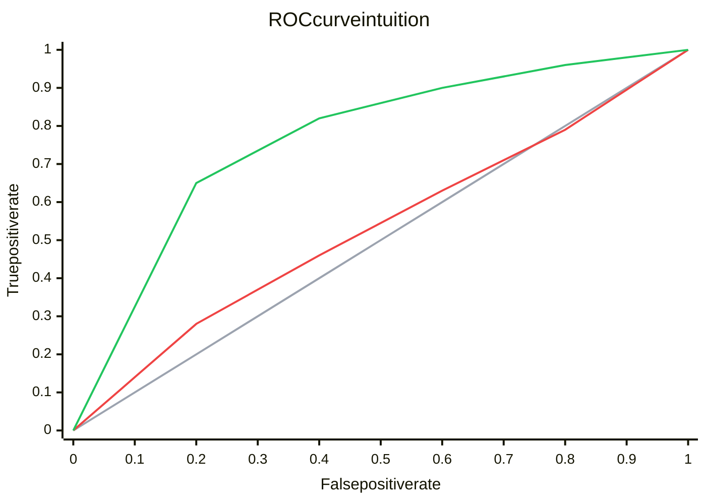
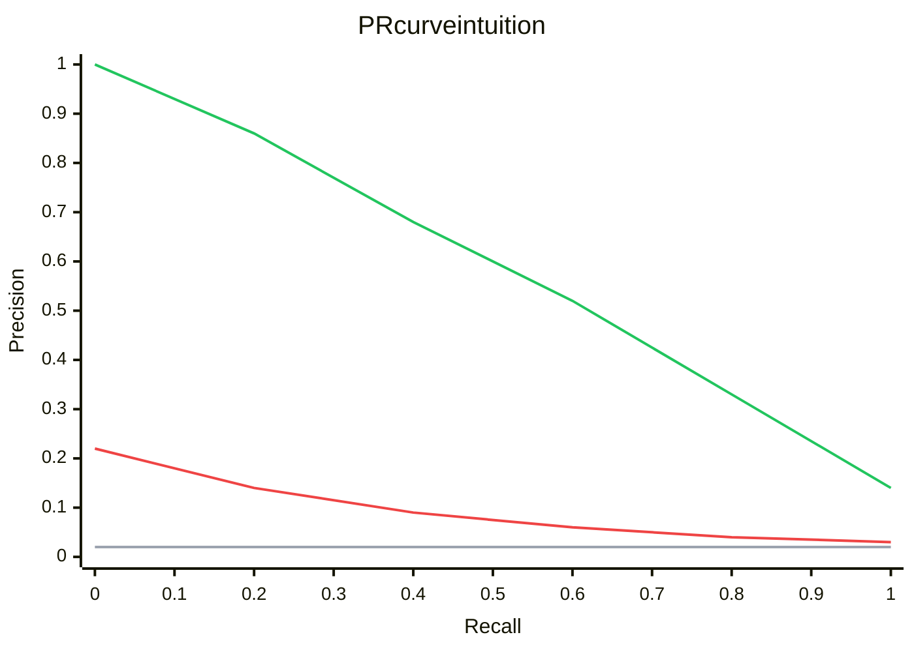

ROC-AUC and PR-AUC summarize how a binary classifier ranks cases while its score threshold sweeps from strict to permissive. ROC plots true-positive rate against false-positive rate. PR plots precision against recall.

ROC-AUC answers a broad ranking question and has a fixed random baseline of 0.5. PR-AUC puts the positive class in the foreground, making false positives visible when positives are rare. Its baseline moves with prevalence, so a PR-AUC value has little meaning without the positive rate.

Both belong in the evaluation stage of [[AI & ML/Machine Learning/Machine Learning|Machine Learning]], especially for binary [[AI & ML/Machine Learning/Types/Types|learning types]] and rare-event detection. Neither picks a production threshold.

# How the Curves Are Built

At each threshold, the confusion matrix changes. Those counts produce one point on each curve.



The gray ROC line is random ranking. The red model gains some true positives as false positives increase. The green model keeps a higher true-positive rate at the same false-positive rate. Curves near the top-left corner rank more useful cases early.



The gray PR line sits at the positive-class prevalence. The red model loses precision quickly as recall rises, so its alert queue fills with false positives. The green model keeps more correct alerts while recovering a larger share of positives.

Area compresses each curve into one number. `ROC AUC` has a useful probabilistic interpretation: it is the chance that a randomly chosen positive receives a higher score than a randomly chosen negative, with a tie counted as half. PR-AUC has no equally simple ranking interpretation, and library implementations may use different interpolation rules.

ML.NET exposes `AreaUnderRocCurve` and `AreaUnderPrecisionRecallCurve` on `BinaryClassificationMetrics` after `mlContext.BinaryClassification.Evaluate`.

## Choosing the Metric

`ROC AUC` fits when the goal is pairwise ranking over both classes and the false-positive rate is meaningful at the expected prevalence. `PR AUC` fits better when the positive class is rare and the system cares about the quality of positive alerts. For either metric, the informative part of the curve is near the actual capacity or cost constraint. A global area can reward regions that production will never use.

## Example

This ML.NET example prints both areas from the same predictions:

```csharp
using Microsoft.ML;
using Microsoft.ML.Data;

var mlContext = new MLContext(seed: 42);

var data = mlContext.Data.LoadFromTextFile<ModelInput>(
    "transactions.csv", hasHeader: true, separatorChar: ',');

var split = mlContext.Data.TrainTestSplit(data, testFraction: 0.3);

var pipeline = mlContext.Transforms
    .NormalizeMinMax("Features")
    .Append(mlContext.BinaryClassification.Trainers
        .SdcaLogisticRegression(labelColumnName: "Label", featureColumnName: "Features"));

var model = pipeline.Fit(split.TrainSet);
var predictions = model.Transform(split.TestSet);

var metrics = mlContext.BinaryClassification.Evaluate(predictions, labelColumnName: "Label");

Console.WriteLine($"ROC-AUC:  {metrics.AreaUnderRocCurve:F3}");
Console.WriteLine($"PR-AUC:   {metrics.AreaUnderPrecisionRecallCurve:F3}");
Console.WriteLine($"F1:       {metrics.F1Score:F3}");
Console.WriteLine($"Accuracy: {metrics.Accuracy:F3}");

// Input schema
public class ModelInput
{
    [LoadColumn(0)]
    public bool Label { get; set; }

    [LoadColumn(1, 20), VectorType(20)]
    public float[] Features { get; set; } = default!;
}
```

High ROC-AUC with weak PR-AUC can mean the broad ranking is good while the positive queue remains noisy. Accuracy adds little when negatives dominate.

## Baselines and Operating Points

A random ranker has ROC-AUC 0.5. Its expected precision is the prevalence `P / (P + N)`, so the PR baseline changes when the dataset does. A perfect ranker reaches 1.0 on both areas.

Threshold selection needs a constraint rather than a visually appealing knee. A review team may require precision ≥ 0.8 because false alarms consume capacity. A screening system may require recall ≥ 0.9. The threshold is swept on validation data, a point that satisfies the constraint is chosen, and the frozen point is then evaluated on separate test data.

# Pitfalls

- **A strong global area can hide a weak operating region.** Precision, recall, and queue volume near the threshold that production can afford show how the model will actually behave.
- **PR-AUC changes with prevalence.** Comparing it across datasets with different positive rates mixes model quality with dataset composition.
- **AUC does not choose a threshold.** The operating point still comes from costs, capacity, or a safety constraint.
- **Ranking is not [[Calibration]].** High AUC does not make a score of 0.8 mean an 80% event probability.
- **Leakage raises every offline curve.** A trustworthy offline evaluation uses only features available at inference time and a split that matches deployment.

# Tradeoffs

| Metric | Measures | Fits when | Misleads when |
|---|---|---|---|
| ROC-AUC | Pairwise ranking of positives above negatives | General ranker comparison. Both classes matter | Rare positives and the positive queue is the real concern |
| PR-AUC | Precision-recall behavior for the positive class | Rare-event alerts and review queues | Prevalence differs across evaluation sets |
| F1 | Precision-recall balance at one threshold | A threshold is fixed and both errors have similar importance | Costs are asymmetric or the threshold may change |
| Log loss | Probability quality, with a sharp penalty for confident errors | Downstream logic consumes calibrated probabilities | Only ranking matters or labels are very noisy |

# Questions

<!-- qard-id: ee85524e-8de1-456c-8814-f0f6b88dc4bd -->

> [!qard]- What does ROC-AUC show about a classifier?
> ROC-AUC shows how well a binary classifier's scores rank positive cases above negative cases, summarized across all decision thresholds.
>
> The ROC curve comes from sweeping the threshold from strict to permissive. Each threshold gives one point on the curve. The point plots the true-positive rate (the share of positives flagged) against the false-positive rate (the share of negatives wrongly flagged).
>
> The area under this curve has a direct ranking meaning. An AUC of 0.8 means that a randomly chosen positive gets a higher score than a randomly chosen negative about 80% of the time, with ties counted as half. Random ranking gives about 0.5, and perfect ranking gives 1.0.
>
> Because it summarizes ranking over every threshold, ROC-AUC does not:
>
> - **choose an operating threshold:** that choice still depends on error costs, review capacity or a required precision or recall;
> - **show calibration:** a model with a high AUC can give a case a score of 0.9 without that score meaning a 90% probability of the event.
>
> [scikit-learn: ROC and model evaluation](https://scikit-learn.org/stable/modules/model_evaluation.html) · [Hanley and McNeil: The meaning and use of the area under a ROC curve](https://doi.org/10.1148/radiology.143.1.7063747)

<!-- qard-id: 4c2fb4ac-42d0-41fa-a56e-0c98344f7315 -->

> [!qard]- When is PR-AUC especially useful alongside ROC-AUC?
> PR-AUC is especially useful when positives are rare and the system acts on positive predictions, as with fraud alerts or review queues. ROC-AUC still describes overall ranking. PR-AUC adds whether the predicted positives are mostly correct, which ROC-AUC can hide.
>
> - **Why ROC-AUC can look strong:** the false-positive rate divides false positives by all negatives. With many negatives, even a large number of false alarms gives a small rate. For example, with 100 positives and 100,000 negatives, catching 80 positives while flagging 1,000 negatives gives a false-positive rate of 1%, yet only 80 of the 1,080 alerts, about 7%, are correct.
> - **What PR shows:** precision is the share of alerts that are correct, and recall is the share of positives found. Both measures focus on the positive class, so false alarms that consume review capacity stay visible.
>
> Two qualifications apply when reading a PR-AUC value:
>
> - **The baseline depends on prevalence:** a random ranker's expected precision equals the positive rate. A PR-AUC value is therefore meaningful only next to that rate. Comparing values across datasets with different positive rates mixes model quality with dataset composition. The evaluation set needs to match the production population and workload.
> - **Implementations differ:** average precision, trapezoidal areas and interpolated areas under the PR curve can give different values. A reported PR-AUC is comparable only when the calculation method is known.
>
> [Davis and Goadrich: The Relationship Between Precision-Recall and ROC Curves](https://doi.org/10.1145/1143844.1143874) · [scikit-learn: average\_precision\_score](https://scikit-learn.org/stable/modules/generated/sklearn.metrics.average_precision_score.html)

# References

- [ML.NET evaluate binary classification model](https://learn.microsoft.com/dotnet/machine-learning/resources/metrics#evaluation-metrics-for-binary-classification)
- [The Relationship Between Precision Recall and ROC Curves](https://dl.acm.org/doi/10.1145/1143844.1143874)
- [Precision Recall Plot is More Informative than the ROC Plot when Evaluating Binary Classifiers on Imbalanced Datasets](https://www.ncbi.nlm.nih.gov/pmc/articles/PMC4349800/)
