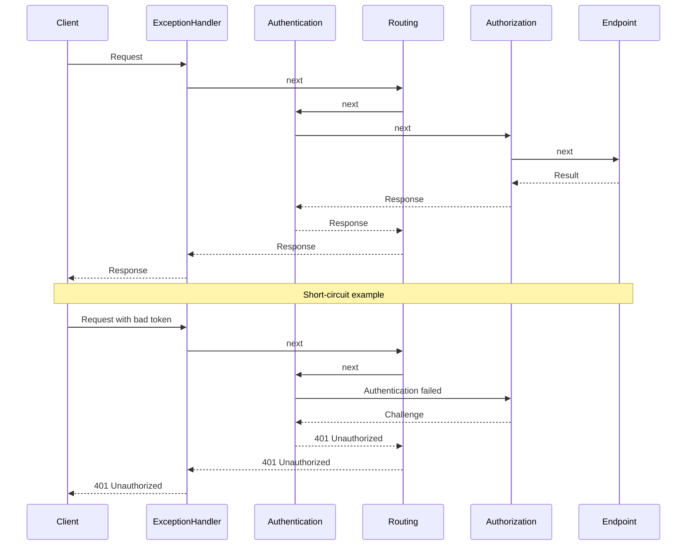

ASP.NET Core middleware forms an ordered chain around endpoint execution. Each component can inspect the inbound request, call the next delegate, and then observe the outbound response. This is the right boundary for behavior that spans many endpoint types, such as exception handling, request logging, CORS, or authentication.

Every component receives `HttpContext` and a delegate for the rest of the chain. Calling `next` passes control inward. Returning without it short-circuits the request. Authentication normally tries to establish `HttpContext.User` and continues. Authorization is the component that challenges or forbids access when endpoint policy requires it.



In the 401 branch, authentication records the failed credential and the pipeline reaches authorization. Authorization triggers the unauthenticated challenge, and the configured authentication handler produces the scheme-specific 401 response.

Registration order is control flow. The first component runs first for the request and last while the response unwinds. A common API pipeline looks like this, with environment-specific pieces such as HSTS enabled only where appropriate:

```csharp
app.UseExceptionHandler("/error");
app.UseHsts();
app.UseHttpsRedirection();
app.UseStaticFiles();
app.UseRouting();
app.UseCors();
app.UseAuthentication();
app.UseAuthorization();
app.MapControllers();
```

# Writing Custom Middleware

An inline lambda is enough for one local concern:

```csharp
app.Use(async (ctx, next) =>
{
    var sw = System.Diagnostics.Stopwatch.StartNew();
    try
    {
        await next(ctx);
    }
    finally
    {
        sw.Stop();
        app.Logger.LogInformation("{Method} {Path} -> {StatusCode} in {ElapsedMs} ms",
            ctx.Request.Method,
            ctx.Request.Path,
            ctx.Response.StatusCode,
            sw.ElapsedMilliseconds);
    }
});
```

A reusable conventional middleware class receives the next delegate through its constructor and exposes `Invoke` or `InvokeAsync`:

```csharp
public sealed class CorrelationIdMiddleware
{
    private readonly RequestDelegate _next;
    private readonly ILogger<CorrelationIdMiddleware> _logger;

    public CorrelationIdMiddleware(RequestDelegate next, ILogger<CorrelationIdMiddleware> logger)
    {
        _next = next;
        _logger = logger;
    }

    public async Task InvokeAsync(HttpContext context)
    {
        var correlationId = context.Request.Headers["X-Correlation-Id"].FirstOrDefault()
            ?? Guid.NewGuid().ToString("N");

        context.Response.Headers["X-Correlation-Id"] = correlationId;
        using (_logger.BeginScope(new Dictionary<string, object> { ["CorrelationId"] = correlationId }))
        {
            await _next(context);
        }
    }
}

// Registration
app.UseMiddleware<CorrelationIdMiddleware>();
```

> [!WARNING]
> **Conventional middleware is constructed once.** Constructor dependencies therefore need lifetimes compatible with the application-long instance. Scoped services belong in `InvokeAsync` parameters, where the framework resolves them from the current request scope. `IMiddleware` plus DI registration is the alternative when the middleware object itself needs a scoped or transient lifetime.

# Branching the Pipeline

The pipeline can branch as well as continue linearly:

- **`app.Map("/admin", branch => ...)`** and **`MapWhen(predicate, ...)`** select a terminal sub-pipeline by path or predicate.
- **`app.UseWhen(predicate, branch => ...)`** runs a conditional branch and then rejoins the main chain when that branch reaches its end.
- **`app.Run(handler)`** installs a terminal delegate that never calls `next`.

```csharp
app.UseWhen(
    ctx => ctx.Request.Path.StartsWithSegments("/api"),
    api => api.UseMiddleware<ApiKeyMiddleware>()); // only /api gets the API-key check
```

# Pitfalls

**Wrong registration order.** Authorization placed before authentication evaluates an anonymous principal. CORS placed after authorization may miss challenged preflights. The exact pipeline varies, but dependencies between components do not.

**Changing a started response.** Once `Response.HasStarted` is true, the status and headers may already be on the wire. Post-`next` code must check that state before attempting changes.

**Blocking I/O.** `Thread.Sleep` and synchronous database or file calls hold a thread-pool thread while the request waits. Middleware wrapping I/O should remain asynchronous through the whole call chain.

**Swallowing exceptions.** Logging and returning 200 converts a failure into a false success. An exception boundary should either rethrow or deliberately write the API's error contract.

**Reading endpoint metadata before routing.** `context.GetEndpoint()` is populated only after endpoint selection. Middleware that depends on authorization or custom endpoint metadata must run after routing and before endpoint execution.

# Tradeoffs

| Option | Best for | Weakness |
|---|---|---|
| Middleware | App-wide cross-cutting concerns (logging, auth, exception handling, CORS) | No direct MVC action context. Coverage depends on registration order and branches; static-file middleware can short-circuit later components |
| MVC action filters | Concerns tied to controllers/actions and model/action context | Only applies to MVC pipeline. Not available for Minimal APIs |
| Endpoint filters | Minimal API endpoint-scoped behavior | Not used by MVC controllers |

Middleware fits a concern that belongs outside a particular endpoint model or must cover several request types. Filters fit logic that needs MVC action context or Minimal API invocation context.

# Questions

<!-- qard-id: 044cb1c8-912a-42fc-82d3-f9e2167680f6 -->

> [!qard]- How does middleware differ from an MVC action filter?
> Middleware runs in the general ASP.NET Core request pipeline for every request that reaches it, and it can run before an endpoint is selected. An MVC action filter runs only inside MVC, around a controller action after that action has been selected. It can read and change the action's arguments and result.
>
> | Aspect | Middleware | MVC action filter |
> |---|---|---|
> | Position | A pipeline component that runs in registration order and can run before routing selects an endpoint. | Runs inside MVC after action selection, immediately before and after the action method. |
> | Requests covered | Every request that reaches it, including static files, Minimal API endpoints and requests that never enter MVC. An earlier component that short-circuits, or a branch that bypasses it, removes that coverage. | Only the controller actions the filter is applied to. |
> | Context | `HttpContext` and the rest of the pipeline. It has no model-bound arguments or action result. | Action context: model-bound arguments, which it can read or replace before the action runs, and the result, which it can inspect or replace afterward. |
> | Fits | Concerns that span endpoint types, such as exception handling, request logging, CORS and authentication. | Behavior that depends on action arguments or results for a set of controllers or actions. |
>
> Minimal API endpoints do not run MVC action filters. Their endpoint-scoped equivalent is endpoint filters.
>
> [Microsoft: Filters in ASP.NET Core](https://learn.microsoft.com/en-us/aspnet/core/mvc/controllers/filters?view=aspnetcore-10.0) · [Microsoft: Middleware in Minimal API apps](https://learn.microsoft.com/en-us/aspnet/core/fundamentals/minimal-apis/middleware?view=aspnetcore-10.0)

<!-- qard-id: 8d463f18-1072-4f4b-b785-c13f213e9fc9 -->

> [!qard]- How can an ASP.NET Core application handle unhandled exceptions consistently?
> A single exception-handling middleware, such as `UseExceptionHandler`, is registered near the start of the pipeline so that it wraps every later component. It turns any unhandled exception from those components into one safe, consistent error response. In ASP.NET Core 8 and later, a registered `IExceptionHandler` implementation can keep the mapping from exception to response in one place.
>
> 1. A later component or the endpoint throws. The exception propagates back out through each `next` call until it reaches the handler.
> 2. A safe server-side diagnostic records the failure. This diagnostic is arranged deliberately, not assumed. In ASP.NET Core 10, when an `IExceptionHandler` reports an exception as handled, the middleware's own diagnostics are suppressed by default. The handler therefore records what an investigation needs.
> 3. The handler writes the application's error contract: an error status code and a body. With `AddProblemDetails()` registered, that body can be a standard Problem Details response.
> 4. Production responses omit stack traces and other sensitive details.
>
> Limits:
>
> - **Coverage:** components registered before the handler are outside it, so their exceptions are not caught.
> - **Started responses:** once the response has started, the status code and headers may already be sent. The handler then cannot reliably replace them with an error response.
> - **Swallowing:** logging the exception but returning a success status hides the failure from clients. The boundary either writes a real error response or lets the exception continue.
>
> [Microsoft: Handle errors in ASP.NET Core](https://learn.microsoft.com/en-us/aspnet/core/fundamentals/error-handling?view=aspnetcore-10.0)

<!-- qard-id: b38ff0ad-a54f-4c82-ba97-6f472c68d084 -->

> [!qard]- How does a request move through the ASP.NET Core middleware pipeline?
> A request passes inward through middleware in registration order until something produces a response, normally the endpoint. The response then passes back outward through the same components in reverse order.
>
> 1. Each component receives `HttpContext` and a `next` delegate. Code before `await next(context)` runs on the way in.
> 2. A component either calls `next` to pass control inward, or returns without calling it to short-circuit. After a short-circuit, later components and the endpoint do not run.
> 3. In a typical API pipeline, routing selects the endpoint. Authentication then tries to establish `HttpContext.User` and normally continues even without a valid credential. Authorization evaluates the endpoint's policy. If the caller fails it, authorization triggers the scheme's challenge for an unauthenticated caller, or forbid for an authenticated one. The scheme decides the response, for example `401` or `403` for bearer tokens, or a redirect for cookies.
> 4. The endpoint runs and produces the response.
> 5. Control returns through earlier components in reverse order, so code after `next` runs on the way out.
>
> Code after `next` can change the status code or headers only while the response has not started. Once `Response.HasStarted` is true, they may already be on the wire. Branches such as `Map` and `UseWhen` change which components a request passes through, so order within a branch matters as well.
>
> [Microsoft: Middleware in Minimal API apps](https://learn.microsoft.com/en-us/aspnet/core/fundamentals/minimal-apis/middleware?view=aspnetcore-10.0) · [Microsoft: ASP.NET Core authentication overview](https://learn.microsoft.com/en-us/aspnet/core/security/authentication/?view=aspnetcore-10.0) · [Microsoft: Handle errors in ASP.NET Core](https://learn.microsoft.com/en-us/aspnet/core/fundamentals/error-handling?view=aspnetcore-10.0)

# References

- [Middleware in ASP.NET Core](https://learn.microsoft.com/en-us/aspnet/core/fundamentals/middleware/)
