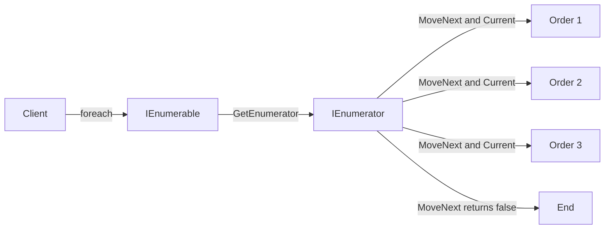

A TV remote exposes "next channel" without exposing the channel store. The source might be a local list or a live feed. The traversal control stays the same. That cursor-like boundary is the Iterator pattern.

Iterator provides sequential access while keeping the collection representation private. In C#, `IEnumerable<T>` produces an iterator and `IEnumerator<T>` tracks the current position. `foreach` consumes that contract, while `yield return` lets the compiler generate the state machine. `IAsyncEnumerable<T>` applies the same boundary when advancing may require asynchronous work.



# Problem

`OrderRepository` materializes the entire order history even when the caller needs only a few rows:

```csharp
public class OrderRepository
{
    // ⚠️ Loads ALL orders into memory before returning
    public async Task<List<Order>> GetOrderHistoryAsync(Guid customerId)
    {
        return await _db.Orders
            .Where(o => o.CustomerId == customerId)
            .OrderByDescending(o => o.CreatedAt)
            .ToListAsync(); // ⚠️ customer with 50,000 orders = 50,000 objects in memory
    }
}

public class OrderHistoryService
{
    public async Task<List<OrderSummary>> GetRecentOrdersAsync(Guid customerId, int count)
    {
        var allOrders = await _repository.GetOrderHistoryAsync(customerId); // ⚠️ loads all 50,000
        return allOrders.Take(count).Select(o => new OrderSummary(o)).ToList(); // uses 20
    }
}
```

A "load more" feature now forces pagination details into callers. The repository returned storage shape instead of traversal behavior.

# Solution

The repository exposes a lazy `IAsyncEnumerable<T>` and keeps paging inside its implementation:

```csharp
public class OrderRepository
{
    // ✅ Returns IAsyncEnumerable — lazy, paginated, caller controls how many to consume
    public async IAsyncEnumerable<Order> GetOrderHistoryAsync(
        Guid customerId,
        [EnumeratorCancellation] CancellationToken ct = default)
    {
        const int pageSize = 100;
        int page = 0;

        while (true)
        {
            var batch = await _db.Orders
                .AsNoTracking()
                .Where(o => o.CustomerId == customerId)
                .OrderByDescending(o => o.CreatedAt)
                .ThenByDescending(o => o.Id) // unique tie-breaker for deterministic pages
                .Skip(page * pageSize)
                .Take(pageSize)
                .ToListAsync(ct);

            if (batch.Count == 0) yield break;

            foreach (var order in batch)
                yield return order; // ✅ caller receives one order at a time

            if (batch.Count < pageSize) yield break;
            page++;
        }
    }
}

public class OrderHistoryService
{
    // ✅ Takes only what it needs — no full load
    public async Task<List<OrderSummary>> GetRecentOrdersAsync(Guid customerId, int count)
    {
        if (count <= 0) return [];

        var summaries = new List<OrderSummary>(count);
        await foreach (var order in _repository.GetOrderHistoryAsync(customerId))
        {
            summaries.Add(new OrderSummary(order));
            if (summaries.Count >= count) break; // ✅ stops iteration early
        }
        return summaries;
    }

    // ✅ Synchronous iterator with yield return
    public IEnumerable<OrderSummary> GetOrderSummaries(IEnumerable<Order> orders)
    {
        foreach (var order in orders)
        {
            if (order.Status == OrderStatus.Cancelled) continue; // ✅ filter inline
            yield return new OrderSummary(order); // ✅ lazy — only computed when consumed
        }
    }
}
```

The caller consumes items through `await foreach`. Database paging remains an implementation detail.

This sample uses offset paging because the iterator boundary is the focus. Offset works for small or mostly static histories, but later pages cost more to scan and concurrent inserts can shift rows between pages even with deterministic ordering. A forward-only production stream should usually carry the last `(CreatedAt, Id)` pair and request the next keyset page instead.

# Enumeration and Streaming APIs in .NET

**`IEnumerable<T>` / `IEnumerator<T>` with `foreach`** is the standard synchronous contract. The loop obtains an enumerator and advances it through `MoveNext()`.

**`yield return`** turns a method body into a generated state machine. Local state survives between calls to `MoveNext()`, so values are produced only as the caller asks for them.

**`IAsyncEnumerable<T>` / `await foreach`** supports sources that wait between items. `Channel<T>.ReadAllAsync()` and EF Core `AsAsyncEnumerable()` expose this shape without requiring one large buffer.

**LINQ `IQueryable<T>`** is deferred query data rather than an iterator by itself. Execution begins when a terminal operation or enumeration asks the provider for results.

# Tradeoffs

**It fits when** sequential access is enough and exposing the underlying structure would couple callers to storage. It is especially useful for large or unbounded sequences. In C#, `yield return` usually removes any reason to implement `IEnumerator<T>` by hand.

**It is a poor fit when** callers need indexed access or a stable `Count`. A materialized list says that more clearly. Deferred execution also moves queries and exceptions to enumeration time. A second enumeration may repeat the work.

**Related patterns.** Iterator controls sequential _access_. **[[Software Architecture/Patterns/Design Patterns/Behavioral/Visitor]]** adds operations over elements, while **[[Software Architecture/Patterns/Design Patterns/Structural/Composite]]** supplies a tree that may be traversed. [[Programming/NET/CSharp/Fundamentals/Foreach|foreach & yield]] covers the language mechanics.

# Questions

<!-- qard-id: d1612460-76a1-4907-9f06-d7453d721a2e -->

> [!qard]- What should determine whether an API returns `IEnumerable<T>`, `IReadOnlyList<T>`, or `IAsyncEnumerable<T>`?
> The return type should state what consumers can do with the result: enumerate it synchronously, count and index it, or await while items arrive. None of the three, by itself, promises that the data is buffered, repeatable or a snapshot.
>
> | Return type | Promises to consumers | Does not promise | Fits when |
> |---|---|---|---|
> | `IEnumerable<T>` | Synchronous, forward-only enumeration. | A count, indexing or materialized data. It may be lazy, so enumerating it again can repeat the work, such as a query, and see different results. | Consumers only iterate, and lazy or streamed production is acceptable. |
> | `IReadOnlyList<T>` | `Count` and access by index, with no mutation members on the interface. | A snapshot or immutability; a producer that keeps the underlying list can still change it. | Consumers need the size or random access, usually for results already in memory. |
> | `IAsyncEnumerable<T>` | Asynchronous streaming: `await foreach` can wait between items, for example while the next page is fetched. | Buffering or repeatability. | Producing items requires I/O, and consumers should process items as they arrive rather than wait for all of them. |
>
> Buffering, repeatability and snapshot semantics form a separate contract; when they matter, the API documentation has to state them.
>
> [.NET: IEnumerable<T>](https://learn.microsoft.com/en-us/dotnet/api/system.collections.generic.ienumerable-1?view=net-10.0) · [.NET: asynchronous streams](https://learn.microsoft.com/en-us/dotnet/csharp/asynchronous-programming/generate-consume-asynchronous-stream)

<!-- qard-id: ecca4dbc-81bf-4e5e-b0dd-dc92b3d938fc -->

> [!qard]- What does the compiler generate for a `yield return` method?
> The compiler rewrites an iterator method into a generated state-machine class that implements the returned iterator interfaces, such as `IEnumerable<T>` and `IEnumerator<T>`. The body is split at each `yield return`, and the object records where execution stopped and keeps the values that must survive between steps.
>
> 1. Calling the method only creates the state-machine object. None of the body runs yet.
> 2. The first `MoveNext()` runs the body from the start to the first `yield return`, stores the yielded value as `Current`, saves its position and returns `true`.
> 3. Each later `MoveNext()` resumes just after the saved position and runs to the next `yield return`.
> 4. Reaching the end of the body or a `yield break` makes `MoveNext()` return `false`.
>
> Locals and parameters used across a `yield return` are kept in the generated object, so their values survive between `MoveNext()` calls. Because the body runs only during enumeration, its work and exceptions, including argument checks, happen when the sequence is consumed rather than when the method is called. The generated type and field names are compiler implementation details.
>
> [C#: yield statement](https://learn.microsoft.com/en-us/dotnet/csharp/language-reference/statements/yield)

# References

- [Iterator pattern](https://refactoring.guru/design-patterns/iterator)
- [Iterator Pattern — Christopher Okhravi](https://www.youtube.com/watch?v=uNTNEfwYXhI\&list=PLrhzvIcii6GNjpARdnO4ueTUAVR9eMBpc\&index=16)
- [`IEnumerable<T>` — .NET Iterator interface](https://learn.microsoft.com/en-us/dotnet/api/system.collections.generic.ienumerable-1)
