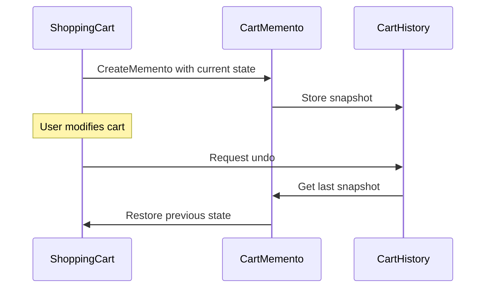

A video-game save point is a memento. It captures enough state to restore a particular moment after a failed attempt. The save system stores that snapshot without needing to understand every internal object that produced it.

The Memento pattern captures an object's state for later restoration without handing its internals to the history mechanism. The **originator** creates and restores snapshots. A **caretaker** stores them as opaque values. This ownership boundary matters more than the snapshot format: only the originator interprets its saved state.



# Problem

A shopping cart has no undo boundary. Removing an item changes live state immediately, while recovery logic would have to reconstruct that state from the outside:

```csharp
public class ShoppingCart
{
    public List<CartItem> Items { get; set; } = [];
    public string? DiscountCode { get; set; }
    public decimal Total => Items.Sum(i => i.Price * i.Quantity);

    // ⚠️ No way to undo — once an item is removed, it's gone
    public void RemoveItem(Guid productId) =>
        Items.RemoveAll(i => i.ProductId == productId);

    // ⚠️ No snapshot capability — abandoned cart recovery requires external logic
}

public class CartController
{
    public IActionResult RemoveItem(Guid productId)
    {
        _cart.RemoveItem(productId);
        // ⚠️ Customer immediately regrets this — no undo button
        return Ok();
    }
}
```

"Undo last change" now requires external code to know how a valid cart is assembled. Encapsulation has already been lost.

# Solution

`CartMemento` records a cart snapshot, and `CartHistory` stores snapshots without interpreting them:

```csharp
// Memento — immutable snapshot of cart state
public sealed record CartMemento(
    IReadOnlyList<CartItem> Items,
    string? DiscountCode,
    DateTime SnapshotAt);

// Originator — creates and restores from mementos
public class ShoppingCart
{
    private List<CartItem> _items = [];
    public string? DiscountCode { get; private set; }
    public IReadOnlyList<CartItem> Items => _items.AsReadOnly();
    public decimal Total => _items.Sum(i => i.Price * i.Quantity);

    public void AddItem(CartItem item) => _items.Add(item);
    public void RemoveItem(Guid productId) => _items.RemoveAll(i => i.ProductId == productId);
    public void ApplyDiscount(string code) => DiscountCode = code;

    // ✅ Creates a snapshot of current state
    public CartMemento Save() =>
        new(_items.Select(i => i with { }).ToList().AsReadOnly(), DiscountCode, DateTime.UtcNow);

    // ✅ Restores state from a snapshot
    public void Restore(CartMemento memento)
    {
        _items = memento.Items.Select(i => i with { }).ToList(); // shallow record copies
        DiscountCode = memento.DiscountCode;
    }
}

// Caretaker — stores mementos without inspecting them
public class CartHistory
{
    private readonly Stack<CartMemento> _history = new();

    public void Push(CartMemento memento) => _history.Push(memento);

    public CartMemento? Pop() => _history.TryPop(out var m) ? m : null;

    public bool CanUndo => _history.Count > 0;

    // ✅ Serialize for abandoned cart recovery
    public string Serialize() => JsonSerializer.Serialize(_history.ToArray());
    public static CartHistory Deserialize(string json)
    {
        var history = new CartHistory();
        var mementos = JsonSerializer.Deserialize<CartMemento[]>(json) ?? [];
        foreach (var m in mementos.Reverse()) history.Push(m);
        return history;
    }
}

// Usage
var cart = new ShoppingCart();
var history = new CartHistory();

cart.AddItem(new CartItem(laptopId, 1, 1299m));
history.Push(cart.Save()); // ✅ snapshot before change

cart.RemoveItem(laptopId); // customer removes item

// Customer clicks "Undo"
if (history.CanUndo)
    cart.Restore(history.Pop()!); // ✅ laptop is back
```

The same snapshot can be serialized for abandoned-cart recovery. Restoration still runs through `ShoppingCart`.

This compact example keeps `CartMemento` public, so opacity is conventional rather than enforced: `CartHistory` can read its properties but has no reason to. A stricter design exposes an opaque interface or nests the memento type inside `ShoppingCart`. The `with` expressions are shallow copies and are safe only when the entire `CartItem` object graph is immutable. Mutable nested objects require explicit deep-copy logic.

# Snapshots in EF Core, JSON, and DataSet

**EF Core `EntityEntry.OriginalValues`**, reached through `context.Entry(entity)`, retains the original property values for a tracked entity. Copying them back into `CurrentValues` restores that tracked value set, which resembles a memento within EF Core's unit-of-work boundary.

**JSON serialization** can serve as a memento format when the serialized contract contains all required state. The hard part is versioning and deep-copy correctness, not calling `JsonSerializer`.

**`DataSet.GetChanges()` / `RejectChanges()`** retain row versions and can reject pending edits. The dataset itself owns the restoration semantics.

# Tradeoffs

**Memento fits when** an object must restore in-memory state while keeping the snapshot opaque to history code. Editors and multi-step workflows are common fits because a change may touch several related fields at once.

**Memento is a poor fit when** snapshots are large and changes are small. Command-based undo stores an inverse operation instead of a full copy. A durable audit history points toward [[Software Architecture/Patterns/Architectural Patterns/Event Sourcing]], where events are the record and snapshots are only an optimization.

**Compared with Command undo**, a Command stores how to reverse one action. A Memento stores prior state. Commands are leaner when the state is large and edits are small. Mementos are easier when one user action changes several internal values. Shared mutable references invalidate either choice, so snapshots need real copy semantics.

# Questions

> [!qard]- What is the Memento pattern?
> The Memento pattern captures an object's state as a snapshot so the object can be restored to it later, without exposing the object's internals to the code that keeps the history.
>
> - **Originator:** the object whose state is saved, such as a shopping cart. It creates mementos and restores itself from them, so it is the only code that interprets the saved state.
> - **Memento:** the snapshot itself, ideally immutable and opaque to everything except the originator.
> - **Caretaker:** stores mementos, for example in an undo stack, without inspecting or changing them.
>
> Undo follows from these roles: before a change, the originator produces a memento and the caretaker keeps it; to undo, the caretaker hands the memento back and the originator restores its state from it.
>
> The snapshot must be a real copy. If it shares mutable objects with live state, later edits also change the saved snapshot, so mutable nested objects need deep copies.
>
> In C#, opacity is often only a convention: a public memento record can still be read by the caretaker. A stricter design exposes an opaque interface or nests the memento type inside the originator.
>
> [[Software Architecture/Patterns/Design Patterns/Behavioral/Memento#Solution|Memento implementation]]

<!-- qard-id: 7e2fad33-bba2-498d-9ab0-1d8be9220e08 -->

> [!qard]- How can memento history be kept from growing without limit?
> Memento history is bounded by a retention limit: a maximum number of snapshots, a memory budget, or both. When a new snapshot would exceed the limit, the oldest one is discarded.
>
> Each snapshot copies the originator's state, so an unbounded history grows with every recorded change. The right limit depends on what the history is for:
>
> - **Undo in an editor:** a rolling window keeps the most recent steps. Steps older than the window can no longer be undone.
> - **Large snapshots:** a memory budget caps total size, because a snapshot count alone does not control memory when individual snapshots can be large.
> - **Recovery after a crash or abandoned session:** often only the latest checkpoint is needed, so earlier snapshots can be dropped.
>
> Storing a small inverse change instead of a full copy makes each entry smaller, but it does not bound the history by itself.
>
> A full audit trail is a different requirement. It needs durable records of events or changes, as in Event Sourcing, rather than an unlimited in-memory stack of object copies.
>
> [[Software Architecture/Patterns/Design Patterns/Behavioral/Memento#Tradeoffs|Memento tradeoffs]]

<!-- qard-id: 4c943112-f943-46a9-ab18-f23765b120e5 -->

> [!qard]- When is Memento overkill compared to simpler approaches?
> Memento is overkill when each change is small and isolated compared with the whole state. Recording how to reverse that one change, as Command-style undo does, is then cheaper and simpler than copying the entire state before every step.
>
> | Aspect | Inverse change (Command-style undo) | Memento snapshot |
> |---|---|---|
> | What each history entry stores | Only what reverses one action, such as a removed item and its former position. | A copy of the originator's earlier state. |
> | Cost per entry | Grows with the size of the change, so small edits to a large object stay cheap. | Grows with the size of the state, so every step pays for a full copy even when little changed. |
> | Main correctness risk | The entry must keep enough context to reverse the change safely; a missing detail produces a wrong reversal. | The copy must not share mutable objects with live state; otherwise later edits also change the snapshot. |
> | Best fit | Isolated, reversible edits. | One action that changes several interdependent values, or a need to restore a complete earlier state. |
>
> A Memento earns its cost when one action touches several related values. Restoring the snapshot resets them together, so no separate inverse logic is needed for each value.
>
> [[Software Architecture/Patterns/Design Patterns/Behavioral/Memento#Tradeoffs|Memento tradeoffs]] · [[Software Architecture/Patterns/Design Patterns/Behavioral/Memento#Solution|Memento implementation]]

# References

- [Memento pattern](https://refactoring.guru/design-patterns/memento)
- [ChangeTracker — EF Core's built-in Memento for entity state tracking](https://learn.microsoft.com/en-us/ef/core/change-tracking/)
