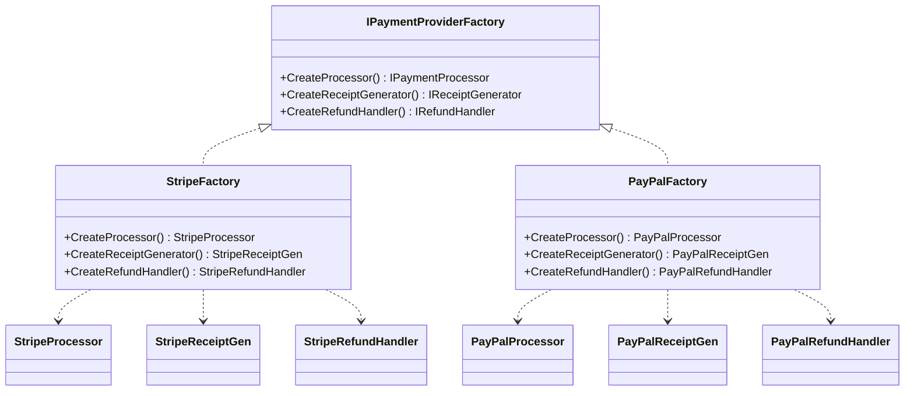

An application may need a matching set of provider-specific objects: a connection, command, and adapter for one database provider, or several payment components built for the same gateway. Selecting the family once is safer than repeating the provider choice at every construction site.

Abstract Factory exposes creation operations for a family of related products without naming their concrete classes in client code. Each concrete factory supplies one family, so replacing the factory replaces the set. The interface centralizes the compatibility decision. It does not prove compatibility by itself: a faulty concrete factory can still return mismatched implementations unless the type system encodes the family more strongly.



> [!NOTE] Abstract Factory vs Factory Method
> [[Software Architecture/Patterns/Design Patterns/Creational/Factory Method]] lets a creator subtype choose one product. Abstract Factory supplies several related product types through a composed factory object. The latter keeps a family choice in one construction boundary, though its correctness still depends on each concrete factory.

# Problem

`CheckoutService` creates payment objects, receipt generators, and refund handlers per provider. Without a factory, provider selection is scattered:

```csharp
public class CheckoutService
{
    public async Task<CheckoutResult> CheckoutAsync(Order order, string provider)
    {
        IPaymentProcessor processor;
        IReceiptGenerator receiptGen;
        IRefundHandler refundHandler;

        // ⚠️ Provider selection duplicated in every method that needs payment objects
        if (provider == "stripe")
        {
            processor = new StripePaymentProcessor(Environment.GetEnvironmentVariable("STRIPE_KEY")!);
            receiptGen = new StripeReceiptGenerator();
            refundHandler = new StripeRefundHandler();
        }
        else if (provider == "paypal")
        {
            processor = new PayPalPaymentProcessor(Environment.GetEnvironmentVariable("PAYPAL_CLIENT_ID")!);
            receiptGen = new PayPalReceiptGenerator();
            refundHandler = new PayPalRefundHandler();
        }
        else
        {
            throw new NotSupportedException($"Provider '{provider}' not supported");
        }
        // ⚠️ Adding BankTransfer means editing this block AND every other place that creates payment objects
        // ⚠️ Nothing prevents mixing StripePaymentProcessor with PayPalReceiptGenerator

        var payment = await processor.ChargeAsync(order.Total, order.Customer.PaymentMethod);
        var receipt = receiptGen.Generate(order, payment);
        return new CheckoutResult(payment, receipt, refundHandler);
    }
}
```

A new provider changes every place that repeats this branch. Direct construction also permits a Stripe processor to be paired with a PayPal receipt generator without any single boundary noticing.

# Solution

A factory interface defines the payment family. Each provider implements the full family:

```csharp
// Abstract products
public interface IPaymentProcessor
{
    Task<Payment> ChargeAsync(decimal amount, PaymentMethod method);
}

public interface IReceiptGenerator
{
    Invoice Generate(Order order, Payment payment);
}

public interface IRefundHandler
{
    Task<bool> RefundAsync(Payment payment, decimal amount);
}

// Abstract factory — the family contract
public interface IPaymentProviderFactory
{
    IPaymentProcessor CreateProcessor();
    IReceiptGenerator CreateReceiptGenerator();
    IRefundHandler CreateRefundHandler();
}

// Concrete factory — Stripe family (compatibility is centralized here)
public class StripePaymentFactory(StripeOptions options) : IPaymentProviderFactory
{
    public IPaymentProcessor CreateProcessor() => new StripePaymentProcessor(options.ApiKey);
    public IReceiptGenerator CreateReceiptGenerator() => new StripeReceiptGenerator(options.AccountId);
    public IRefundHandler CreateRefundHandler() => new StripeRefundHandler(options.ApiKey);
}

// Concrete factory — PayPal family
public class PayPalPaymentFactory(PayPalOptions options) : IPaymentProviderFactory
{
    public IPaymentProcessor CreateProcessor() => new PayPalPaymentProcessor(options.ClientId, options.Secret);
    public IReceiptGenerator CreateReceiptGenerator() => new PayPalReceiptGenerator(options.MerchantId);
    public IRefundHandler CreateRefundHandler() => new PayPalRefundHandler(options.ClientId, options.Secret);
}

// ✅ Adding BankTransfer = new factory class, zero changes to CheckoutService
public class BankTransferFactory(BankOptions options) : IPaymentProviderFactory
{
    public IPaymentProcessor CreateProcessor() => new BankTransferProcessor(options);
    public IReceiptGenerator CreateReceiptGenerator() => new BankReceiptGenerator(options.BankName);
    public IRefundHandler CreateRefundHandler() => new BankRefundHandler(options);
}

// CheckoutService works against the abstract factory — no provider knowledge
public class CheckoutService(IPaymentProviderFactory factory)
{
    public async Task<CheckoutResult> CheckoutAsync(Order order)
    {
        // All three objects come from one concrete factory, which owns compatibility
        var processor = factory.CreateProcessor();
        var receiptGen = factory.CreateReceiptGenerator();
        var refundHandler = factory.CreateRefundHandler();

        var payment = await processor.ChargeAsync(order.Total, order.Customer.PaymentMethod);
        var receipt = receiptGen.Generate(order, payment);
        return new CheckoutResult(payment, receipt, refundHandler);
    }
}

// DI registration — swap the factory to switch providers
builder.Services.AddSingleton<IPaymentProviderFactory>(
    new StripePaymentFactory(builder.Configuration.GetSection("Stripe").Get<StripeOptions>()!));
```

Bank transfer now has one construction boundary, and `CheckoutService` remains provider-neutral. The compiler enforces the product interfaces returned by the factory, not that their concrete implementations belong to one provider. Tests or stronger family-specific types must protect that invariant.

# Framework examples

**A DI container** is a general object factory and composition root. Grouped registrations can switch several services together, but `IServiceProvider` is not a typed Abstract Factory and does not prevent mixed registrations.

**`DbProviderFactory`** is the clearest .NET example. One provider factory creates connections, commands, adapters, and related ADO.NET objects for that provider. Client code stays on the shared abstractions.

**Hosting builders** assemble related infrastructure through one composition path, but they are primarily Builders rather than textbook Abstract Factories.

# Pitfalls

**Mismatched products.** A shared return interface cannot express that every object came from the same provider. Restricting concrete constructors reduces bypasses. When compatibility is a hard invariant, provider-specific aggregate types or generic family markers can move more of the check into the type system.

**Family growth.** A new product kind such as `IFraudDetector` changes the abstract factory and every family. Splitting the interface is justified only when consumers use genuinely separate families. Arbitrary small interfaces can hide the fact that the products must vary together.

**Selection lifetime.** Startup registration gives the application one family. Per-request selection needs a registry or strategy, plus explicit rules for credentials, retries, and provider-specific state.

# Tradeoffs

| Concern | With Abstract Factory | Without (direct construction) |
|---|---|---|
| Product compatibility | Centralized in one concrete factory. Stronger typing may enforce more | Repeated at each construction site |
| Adding a new provider | One new factory class, zero changes to consumers | Edit every service that creates payment objects |
| Adding a new product type | Add method to interface + implement in every factory | Add creation logic in every service |
| Testability | Inject a `MockPaymentFactory` in tests | Must mock each product individually |
| Complexity | Factory hierarchy adds indirection | Simpler when one product varies or one provider is fixed |

Abstract Factory fits several product types that must vary together across more than one family. A single product abstraction or one fixed provider needs less machinery. The deciding pressure is coordinated variation, not a numeric threshold.

# Questions

<!-- qard-id: 6f975d28-4f0a-4253-9a65-ae9d44e14b87 -->

> [!qard]- What should happen when an Abstract Factory gains a new product type such as `IFraudDetector`?
> It depends on whether every family must provide the new product. If so, the product is added to the abstract factory interface and implemented in every concrete factory. If the capability varies independently of the family, it belongs in a separate collaborator instead of the factory.
>
> - **Required in every family:** the factory interface gains a method such as `CreateFraudDetector()`, and each provider's factory returns its own implementation. A concrete factory without that method fails to compile, so no family is left incomplete. This is the pattern's known cost: each new product type changes the interface and every family.
> - **Independent of the family:** when fraud detection does not have to match the payment provider, it is injected on its own rather than forced into every family's factory.
>
> A default no-op implementation avoids the compile errors but hides a missing required behavior. For a safety check such as fraud detection, payments would then proceed unchecked without any error.
>
> Splitting the factory interface is justified only when consumers use genuinely separate families; arbitrary splitting hides the fact that the products must vary together.
>
> [[Software Architecture/Patterns/Design Patterns/Creational/Abstract Factory#Pitfalls|Abstract Factory pitfalls]] · [[Software Architecture/Patterns/Design Patterns/Creational/Abstract Factory#Solution|Abstract Factory implementation]]

<!-- qard-id: 5afe8a29-5689-48d4-9785-7b2ee30124b1 -->

> [!qard]- When is Abstract Factory overkill compared to a simpler approach?
> Abstract Factory is overkill when only one product type varies, when a single provider is fixed, or when the products can be chosen independently. Injecting each product directly is simpler in those cases.
>
> The pattern adds a factory interface and one concrete factory per family. That layer pays off only when several product types must vary together. Choosing a payment provider, for example, must also choose its matching processor, receipt generator and refund handler, and the factory makes that choice once. Without such a coordinated compatibility requirement, the extra indirection buys nothing.
>
> The deciding pressure is coordinated variation, not a particular number of providers or classes.
>
> [[Software Architecture/Patterns/Design Patterns/Creational/Abstract Factory#Tradeoffs|Abstract Factory tradeoffs]]

<!-- qard-id: 3a40a979-9d08-465f-9aa9-dc46dd4aa503 -->

> [!qard]- How does Abstract Factory relate to the DI container in modern .NET?
> They solve different problems and are often combined. A DI container is a general object factory that builds object graphs from registrations. An Abstract Factory is a typed creation boundary: choosing one concrete factory chooses a whole family of related products.
>
> - **What the container provides:** each service is resolved from its own registration. Registrations can switch several services together, but `IServiceProvider` does not check that the resolved implementations belong to the same provider, so a Stripe processor can sit next to a PayPal receipt generator by mistake.
> - **What the factory adds:** consumers depend on one interface, such as `IPaymentProviderFactory`, and each concrete factory creates all of its family's products. The compatibility decision lives in one place instead of being spread across registrations.
> - **How they combine:** the container registers and injects the chosen concrete factory, for example with `AddSingleton<IPaymentProviderFactory>(...)`. One factory registered at startup fixes one family for the whole application; choosing a family per request needs a registry or strategy that selects among factories.
>
> The factory centralizes compatibility but does not prove it. Its shared product interfaces cannot show that the returned implementations come from one provider; provider-specific types can move more of that check into the type system.
>
> [.NET dependency injection](https://learn.microsoft.com/en-us/dotnet/core/extensions/dependency-injection/overview) · [[Software Architecture/Patterns/Design Patterns/Creational/Abstract Factory#Framework examples|Abstract Factory framework examples]] · [[Software Architecture/Patterns/Design Patterns/Creational/Abstract Factory#Pitfalls|Abstract Factory pitfalls]]

# References

- [Abstract Factory pattern](https://refactoring.guru/design-patterns/abstract-factory)
- [Abstract Factory Pattern — Christopher Okhravi](https://www.youtube.com/watch?v=v-GiuMmsXj4\&list=PLrhzvIcii6GNjpARdnO4ueTUAVR9eMBpc\&index=5)
- [Dependency injection in .NET — container-based object construction](https://learn.microsoft.com/en-us/dotnet/core/extensions/dependency-injection)
