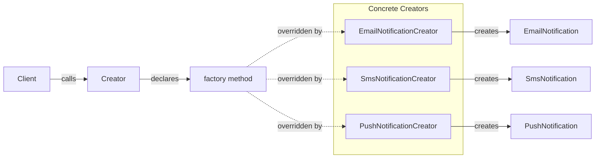

Sometimes a base workflow knows when it needs a collaborator but cannot choose the concrete implementation. A notification workflow can save an order and send a confirmation while a subtype decides whether the sender uses email or SMS.

Factory Method puts that creation decision in an overridable method. Concrete creators override the factory method to supply one product implementation, so product selection varies through creator inheritance. That overridable creation hook is the pattern's defining boundary. A creator often also owns a surrounding algorithm that works with the returned product interface, as the notification workflow does, which keeps the rest of that workflow shared. That collaboration is a common and useful arrangement, but the pattern does not require it.



> [!NOTE] Factory Method vs Abstract Factory
> Factory Method varies one creation step through a creator subtype. [[Software Architecture/Patterns/Design Patterns/Creational/Abstract Factory]] is a composed object that supplies a family of related products. A standalone factory function may be smaller than either when no creator workflow or product family exists.

# Problem

A deployment selects one notification channel at startup, but `OrderService` still owns the channel switch and concrete construction:

```csharp
public class OrderService(string notificationChannel)
{
    public async Task PlaceOrderAsync(Order order)
    {
        await SaveOrderAsync(order);

        // ⚠️ Deployment-fixed selection still leaks into the order workflow
        var channel = notificationChannel;
        if (channel == "email")
        {
            var emailSender = new SmtpEmailSender("smtp.example.com", 587); // ⚠️ hardcoded config
            await emailSender.SendAsync(order.Customer.Email,
                "Order Confirmed", BuildEmailBody(order));
        }
        else if (channel == "sms")
        {
            var smsSender = new TwilioSmsSender(Environment.GetEnvironmentVariable("TWILIO_SID")!);
            await smsSender.SendAsync(order.Customer.Phone, BuildSmsBody(order));
        }
        else if (channel == "push")
        {
            var pushSender = new FirebasePushSender(Environment.GetEnvironmentVariable("FCM_KEY")!);
            await pushSender.SendAsync(order.Customer.DeviceToken, "Order Confirmed", BuildPushBody(order));
        }
        // ⚠️ Adding Slack, webhook, or WhatsApp means editing this method again
    }
}
```

Supporting Slack changes the order workflow even though one creator could be selected once for the whole deployment.

# Solution

Notification construction moves into a creator hierarchy, and the composition root registers one concrete creator for the deployment:

```csharp
// Product interface
public interface INotificationSender
{
    Task SendOrderConfirmationAsync(Order order);
}

// Concrete products
public class EmailNotificationSender : INotificationSender
{
    private readonly SmtpEmailSender _smtp;
    public EmailNotificationSender(SmtpEmailSender smtp) => _smtp = smtp;

    public Task SendOrderConfirmationAsync(Order order) =>
        _smtp.SendAsync(order.Customer.Email, "Order Confirmed", BuildBody(order));

    private static string BuildBody(Order order) =>
        $"Hi {order.Customer.Name}, your order #{order.Id} for {order.Total:C} is confirmed.";
}

public class SmsNotificationSender : INotificationSender
{
    private readonly TwilioSmsSender _twilio;
    public SmsNotificationSender(TwilioSmsSender twilio) => _twilio = twilio;

    public Task SendOrderConfirmationAsync(Order order) =>
        _twilio.SendAsync(order.Customer.Phone,
            $"Order #{order.Id} confirmed. Total: {order.Total:C}");
}

public class SlackNotificationSender : INotificationSender // ✅ new channel = new sender and creator; creator workflow unchanged, composition-root registration updated
{
    private readonly SlackClient _slack;
    public SlackNotificationSender(SlackClient slack) => _slack = slack;

    public Task SendOrderConfirmationAsync(Order order) =>
        _slack.PostAsync(order.Customer.SlackUserId,
            $":white_check_mark: Order #{order.Id} placed — {order.Total:C}");
}

// Creator — declares the factory method
public abstract class NotificationCreator
{
    public abstract INotificationSender CreateSender(); // ✅ factory method

    public async Task NotifyOrderConfirmedAsync(Order order)
    {
        var sender = CreateSender(); // ✅ creator doesn't know the concrete type
        await sender.SendOrderConfirmationAsync(order);
    }
}

// Concrete creators
public class EmailNotificationCreator(SmtpEmailSender smtp) : NotificationCreator
{
    public override INotificationSender CreateSender() => new EmailNotificationSender(smtp);
}

public class SmsNotificationCreator(TwilioSmsSender twilio) : NotificationCreator
{
    public override INotificationSender CreateSender() => new SmsNotificationSender(twilio);
}

// Composition root selects one channel for this deployment
builder.Services.AddSingleton<NotificationCreator, EmailNotificationCreator>();

// OrderService now depends on the abstraction
public class OrderService(NotificationCreator notificationCreator)
{
    public async Task PlaceOrderAsync(Order order)
    {
        await SaveOrderAsync(order);
        await notificationCreator.NotifyOrderConfirmedAsync(order); // ✅ no switch, no channel knowledge
    }
}
```

Slack can be added as another creator subtype without changing the order workflow. The composition root selects the deployment's creator at startup.

# Related .NET factory APIs

**`ILoggerFactory.CreateLogger()`** is a factory API that returns an `ILogger` for a category. It illustrates construction behind an interface, but it is not the textbook inheritance form because consumers do not subclass the creator to override the method.

**`DbProviderFactory`** exposes several creation methods for one database-provider family, making it a closer example of Abstract Factory. Individual methods such as `CreateConnection()` still demonstrate returning a product abstraction without naming its concrete class.

**`Task.FromResult<T>()`** is a static factory function, not the GoF Factory Method pattern. It is useful terminology to distinguish: many APIs called "factory methods" do not involve an overridable creator hierarchy.

# Questions

<!-- qard-id: 387e21f5-e2c0-481e-bb89-cf3370a20ffb -->

> [!qard]- When does Factory Method become the wrong choice?
> Factory Method is the wrong choice when no creator needs an overridable creation hook through which subclasses decide the product. That hook defines the pattern. A shared base workflow that uses the product is a common reason the hook pays off, but it is not required. When nothing needs a subclass creation decision, the creator hierarchy is ceremony.
>
> Simpler or better-fitting options:
>
> - **Implementation chosen once at startup:** a DI registration of the product interface, such as `INotificationSender` mapped to `EmailNotificationSender`, selects the implementation without a creator subclass per variant.
> - **Plain construction:** a static factory method or a constructor is smaller when creating the object needs no subclass decision. Many APIs called factory methods, such as `Task.FromResult<T>()`, are static functions rather than the GoF pattern.
> - **Several related products must vary together:** Abstract Factory keeps the compatible family behind one factory object instead of separate creation hooks.
>
> When each variant gets its own creator subclass, as in the notification example, the cost being avoided is a parallel hierarchy: each new variant adds both a product class and a matching creator class, even when the creator contributes nothing beyond picking the product.
>
> [[Software Architecture/Patterns/Design Patterns/Creational/Factory Method#Related .NET factory APIs|Related .NET factory APIs]] · [[Software Architecture/Patterns/Design Patterns/Creational/Factory Method#Solution|Factory Method solution]] · [Microsoft: .NET dependency injection](https://learn.microsoft.com/en-us/dotnet/core/extensions/dependency-injection/overview) · [GoF: Factory Method pattern](https://people.csail.mit.edu/addy/pattern/pat3c.htm)

<!-- qard-id: 6ba2a5be-041f-4ac2-ad2a-c3f3cd810ee2 -->

> [!qard]- How does Factory Method support the Open/Closed Principle?
> Factory Method lets a new product variant arrive as new code, in the form of a creator subclass, while the creator's existing workflow stays unchanged. That is the Open/Closed Principle at one variation point: the workflow is open to new products but closed to modification.
>
> How a new variant is added:
>
> 1. The base creator runs its workflow and gets the product only through the overridable factory method. In the notification example this is `CreateSender()`, which returns the product interface `INotificationSender`.
> 2. A new channel, such as Slack, adds a `SlackNotificationSender` and a creator subclass whose override returns it.
> 3. The composition root registers the new creator. The shared workflow, the existing creators and the code that calls the workflow are not edited.
>
> The protection covers only the anticipated variation point. A variant that needs a different product contract, or a change to the shared workflow, still requires editing existing code. The composition root that selects the creator also changes when the new creator is put into use.
>
> [Robert C. Martin: Design Principles and Design Patterns](https://objectmentor.com/resources/articles/Principles_and_Patterns.pdf) · [Robert C. Martin: SOLID course notes](https://cleancoder.com/files/solid.md) · [[Software Architecture/Patterns/Design Patterns/Creational/Factory Method#Solution|Factory Method solution]]

# References

- [Factory Method pattern](https://refactoring.guru/design-patterns/factory-method)
- [Factory Method Pattern — Christopher Okhravi](https://www.youtube.com/watch?v=EcFVTgRHJLM\&list=PLrhzvIcii6GNjpARdnO4ueTUAVR9eMBpc\&index=4)
- [ILoggerFactory interface — .NET logging factory method in production use](https://learn.microsoft.com/en-us/dotnet/api/microsoft.extensions.logging.iloggerfactory)
