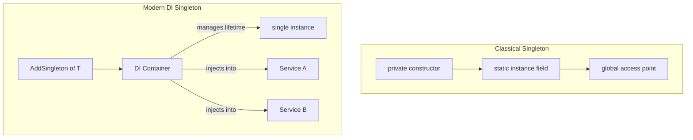

Singleton combines two decisions: keep one instance within a defined boundary and provide access to it. The boundary is easy to miss. A classical static implementation owns a process-level access point, while `.AddSingleton<T>()` reuses one instance for subsequent resolutions from a particular root service provider and registration. A second provider or direct construction can still create another instance.

Application services normally need container-managed lifetime rather than global static access. Constructor injection keeps the dependency visible, lets the container dispose it, and exposes lifetime mistakes during validation. The classical form remains relevant when a library genuinely owns a single access point without a DI container.



# Problem

The classical form below enforces access through `AppConfig.Instance`, but it also hides the dependency from every consumer:

```csharp
// Classical Singleton — the pattern most tutorials show
public class AppConfig
{
    private static AppConfig? _instance;
    private static readonly object _lock = new();

    // ⚠️ Private constructor prevents DI container from creating instances
    private AppConfig()
    {
        ConnectionString = Environment.GetEnvironmentVariable("DB_CONNECTION")!;
        MaxOrdersPerHour = int.Parse(Environment.GetEnvironmentVariable("MAX_ORDERS") ?? "100");
    }

    // ⚠️ Double-checked locking — easy to get wrong, unnecessary with Lazy<T>
    public static AppConfig Instance
    {
        get
        {
            if (_instance is null)
            {
                lock (_lock)
                {
                    _instance ??= new AppConfig();
                }
            }
            return _instance;
        }
    }

    public string ConnectionString { get; }
    public int MaxOrdersPerHour { get; }
}

public class OrderService
{
    public async Task PlaceOrderAsync(Order order)
    {
        // ⚠️ Hidden dependency — not visible in constructor, can't be mocked in tests
        var config = AppConfig.Instance;
        if (await GetOrderCountLastHourAsync(order.Customer.Id) >= config.MaxOrdersPerHour)
            throw new RateLimitException("Order rate limit exceeded");
        // ...
    }
}
```

`OrderService` can no longer declare or replace the configuration it uses. Tests inherit environment access and shared state, and lifetime policy is fixed inside the dependency instead of at the composition root.

# Solution

A normal service registered with singleton lifetime is injected into its consumers. The container controls creation and disposal. The consumer only knows its contract.

```csharp
// ✅ Plain class — no static members, no private constructor
public interface IAppConfig
{
    string ConnectionString { get; }
    int MaxOrdersPerHour { get; }
}

public class AppConfig : IAppConfig
{
    public string ConnectionString { get; init; }
    public int MaxOrdersPerHour { get; init; }

    public AppConfig(IConfiguration configuration)
    {
        ConnectionString = configuration.GetConnectionString("Default")
            ?? throw new InvalidOperationException("DB connection string not configured");
        MaxOrdersPerHour = configuration.GetValue<int>("RateLimiting:MaxOrdersPerHour", 100);
    }
}

// ✅ Register as singleton in DI — one instance for this service contract
builder.Services.AddSingleton<IAppConfig, AppConfig>();

// ✅ OrderService declares its dependency explicitly
public class OrderService(IAppConfig config, IOrderRepository repository)
{
    public async Task PlaceOrderAsync(Order order)
    {
        // ✅ config is injected — can be mocked in tests
        if (await repository.GetOrderCountLastHourAsync(order.Customer.Id) >= config.MaxOrdersPerHour)
            throw new RateLimitException("Order rate limit exceeded");
        await repository.SaveAsync(order);
    }
}

// ✅ Test: inject a mock config with controlled values
[Fact]
public async Task PlaceOrder_ExceedsRateLimit_Throws()
{
    var config = Substitute.For<IAppConfig>();
    config.MaxOrdersPerHour.Returns(5);
    var repository = Substitute.For<IOrderRepository>();
    repository.GetOrderCountLastHourAsync(Arg.Any<Guid>()).Returns(5);

    var service = new OrderService(config, repository);
    await Assert.ThrowsAsync<RateLimitException>(() =>
        service.PlaceOrderAsync(new Order { Customer = new Customer { Id = Guid.NewGuid() } }));
}

// When lazy initialization is genuinely needed (e.g., expensive resource):
public class ExpensiveConnectionPool
{
    // ✅ Lazy<T> is thread-safe by default, no manual locking needed
    private static readonly Lazy<ExpensiveConnectionPool> _instance =
        new(() => new ExpensiveConnectionPool());

    public static ExpensiveConnectionPool Instance => _instance.Value;
    private ExpensiveConnectionPool() { /* expensive initialization */ }
}
```

# Singleton Lifetime in .NET

**`services.AddSingleton<T>()`** caches one service instance in the root provider and returns it for later resolutions. This is a lifetime rule, not proof that no other instance can exist.

**`Lazy<T>`** supplies thread-safe deferred initialization for a classical implementation. It removes hand-written double-checked locking, but it does not remove global state or hidden dependencies.

Singleton services may be stateless or hold shared state. Either way, their implementations and any mutable dependencies must be safe for concurrent callers.

# Pitfalls

**Captive dependency.** A singleton that constructor-injects a scoped service keeps that instance beyond its intended scope. Scope validation rejects this graph. Work that genuinely needs scoped state either creates and disposes an explicit scope for the operation or moves to a scoped service.

**Shared mutable state.** One instance may serve concurrent requests. The container makes resolution thread-safe. It does not make the service's fields or dependencies thread-safe.

**Oversized lifetime.** A singleton retains its dependency graph until the provider is disposed. Large caches, failed state, or request-specific data can then survive far longer than intended.

**Multiple roots.** Calling `BuildServiceProvider` during registration creates another container and therefore another singleton set. The sound structure keeps one composition root and avoids static service locators.

# Questions

<!-- qard-id: 3ccef885-1fa9-4646-9ab0-8a9a97b1da4e -->

> [!qard]- How does a DI singleton differ from the classical Singleton pattern?
> A classical Singleton enforces a single instance inside the class itself and exposes it through a global static access point. A DI singleton is an ordinary class that the container creates once per root provider and injects into consumers, so its single instance is a container lifetime rule rather than a property of the type.
>
> | Aspect | Classical Singleton | DI singleton |
> |---|---|---|
> | Who enforces one instance | The type itself, through a private constructor and a static instance field, often initialized with `Lazy<T>`. | The container: after `AddSingleton<T>()`, the root provider creates the instance on first request and returns the same one for later resolutions. |
> | How consumers get it | Through a static access point such as `AppConfig.Instance`, so the dependency is hidden inside method bodies. | Through constructor injection, so the dependency is visible in the consumer's constructor. |
> | How far the single instance extends | Every caller of the static access point shares it. | One root provider and registration. A second provider, such as one created by calling `BuildServiceProvider` again, or direct construction with `new` produces another instance. |
> | Testing and replacement | Consumers cannot be handed a substitute, and tests share the static state. | Tests pass a fake or substitute to the consumer's constructor. |
> | Creation and disposal | Controlled by the type. | Controlled by the container, which disposes instances it created when the provider is disposed. |
>
> In both forms, one instance serves concurrent callers, so the instance's own state must be thread-safe.
>
> [Microsoft: Service lifetimes](https://learn.microsoft.com/en-us/dotnet/core/extensions/dependency-injection/service-lifetimes) · [Microsoft: .NET dependency injection](https://learn.microsoft.com/en-us/dotnet/core/extensions/dependency-injection/overview) · [[Software Architecture/Patterns/Design Patterns/Creational/Singleton#Problem|Classical Singleton problem]] · [[Software Architecture/Patterns/Design Patterns/Creational/Singleton#Singleton Lifetime in .NET|Singleton lifetime in .NET]]

<!-- qard-id: 8f445829-cfc8-4081-9059-c663ca0a2d49 -->

> [!qard]- What must be true before choosing singleton lifetime for mutable state?
> Singleton lifetime suits mutable state only when four conditions hold: sharing is intended, concurrent access is safe, retained memory is bounded, and no scoped state is captured. One instance serves every caller of its provider until the provider is disposed, usually at application shutdown, so each condition guards against a specific failure.
>
> - **Sharing is intended:** every request and user resolved from that provider sees the same state. If the data really belongs to one request or one user, it leaks between callers.
> - **Concurrent access is safe:** one instance serves concurrent requests. The container makes resolving the service thread-safe, but not the service's fields or dependencies, so unsynchronized mutation causes races and corrupted state.
> - **Retained memory is bounded:** the singleton and its dependency graph live as long as the provider. An unbounded cache keeps growing, and failed or stale state survives far longer than intended.
> - **No scoped state is captured:** a singleton that holds a scoped service keeps that instance beyond its intended scope. This is a captive dependency. When scope validation is enabled, it rejects constructor-injecting a scoped service into a singleton.
>
> When any condition fails, a shorter lifetime such as scoped or transient fits better, or the state needs a different owner. Singleton work that genuinely needs scoped services can create and dispose an explicit scope for each operation.
>
> [Microsoft: Dependency injection guidelines](https://learn.microsoft.com/en-us/dotnet/core/extensions/dependency-injection-guidelines) · [Microsoft: Service lifetimes](https://learn.microsoft.com/en-us/dotnet/core/extensions/dependency-injection/service-lifetimes) · [[Software Architecture/Patterns/Design Patterns/Creational/Singleton#Pitfalls|Singleton pitfalls]]

# References

- [Singleton pattern](https://refactoring.guru/design-patterns/singleton)
- [Singleton Pattern — Christopher Okhravi](https://www.youtube.com/watch?v=hUE_j6q0LTQ\&list=PLrhzvIcii6GNjpARdnO4ueTUAVR9eMBpc\&index=6)
