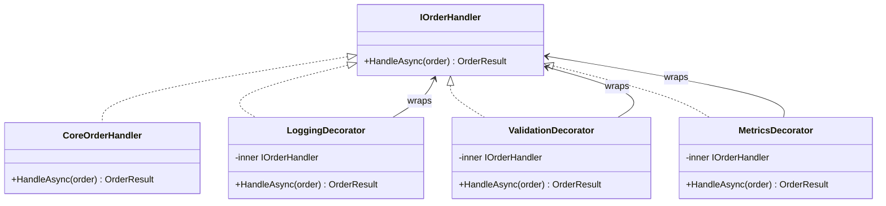

Pizza toppings work as layers over one base. Each layer changes the result without changing the dough underneath, and different combinations can be assembled from the same pieces.

The Decorator pattern adds behavior by wrapping an object with another object that implements the same interface. A decorator keeps a reference to the wrapped component, delegates to it, and runs work before or after that call. Because the wrapper still satisfies the original contract, layers such as `LoggingHandler(ValidationHandler(MetricsHandler(CoreHandler)))` can be composed without changing the client. Order matters because each layer controls when delegation occurs.



> [!NOTE] Decorator vs Proxy
> Both wrap the same interface. Decorator adds behavior such as logging or validation. [[Software Architecture/Patterns/Design Patterns/Structural/Proxy]] controls access to the real object through mechanisms such as authorization or lazy loading. Their structure can look identical. Intent separates them.

# Problem

`OrderProcessor.ProcessOrder()` has growing cross-cutting concerns mixed with core logic:

```csharp
public class OrderProcessor(
    IOrderRepository repository,
    ILogger<OrderProcessor> logger,
    IMetricsCollector metrics,
    IAuditLog auditLog)
{
    public async Task<OrderResult> ProcessOrderAsync(Order order)
    {
        // ⚠️ Logging, metrics, validation, and core logic all interleaved
        logger.LogInformation("Processing order {OrderId}", order.Id);
        var stopwatch = Stopwatch.StartNew();

        try
        {
            // ⚠️ Validation mixed with processing
            if (order.Items.Count == 0)
                throw new InvalidOperationException("Order has no items");
            if (order.Total <= 0)
                throw new InvalidOperationException("Order total must be positive");

            // ⚠️ Audit trail mixed with processing
            await auditLog.RecordAsync($"Order {order.Id} processing started by {order.Customer.Id}");

            var result = await repository.SaveAndProcessAsync(order);

            stopwatch.Stop();
            metrics.RecordOrderProcessingTime(stopwatch.ElapsedMilliseconds);
            logger.LogInformation("Order {OrderId} processed in {Ms}ms", order.Id, stopwatch.ElapsedMilliseconds);

            return result;
        }
        catch (Exception ex)
        {
            logger.LogError(ex, "Order {OrderId} processing failed", order.Id);
            metrics.RecordOrderFailure();
            throw;
        }
        // ⚠️ Adding a new concern (rate limiting, idempotency check) means editing this method
    }
}
```

Adding idempotency requires editing `ProcessOrderAsync`, where it can disturb unrelated processing concerns that already work.

# Solution

Each concern moves into a decorator around the next handler:

```csharp
// Component interface
public interface IOrderHandler
{
    Task<OrderResult> HandleAsync(Order order);
}

// Core handler — pure business logic, no cross-cutting concerns
public class CoreOrderHandler(IOrderRepository repository) : IOrderHandler
{
    public Task<OrderResult> HandleAsync(Order order) =>
        repository.SaveAndProcessAsync(order);
}

// Decorator: validation
public class ValidationOrderHandler(IOrderHandler next) : IOrderHandler
{
    public async Task<OrderResult> HandleAsync(Order order)
    {
        // ✅ Validation isolated — can be tested independently
        if (order.Items.Count == 0)
            throw new InvalidOperationException("Order has no items");
        if (order.Total <= 0)
            throw new InvalidOperationException("Order total must be positive");

        return await next.HandleAsync(order); // ✅ delegates to next in chain
    }
}

// Decorator: logging
public class LoggingOrderHandler(IOrderHandler next, ILogger<LoggingOrderHandler> logger) : IOrderHandler
{
    public async Task<OrderResult> HandleAsync(Order order)
    {
        logger.LogInformation("Processing order {OrderId} for customer {CustomerId}",
            order.Id, order.Customer.Id);
        try
        {
            var result = await next.HandleAsync(order);
            logger.LogInformation("Order {OrderId} processed successfully", order.Id);
            return result;
        }
        catch (Exception ex)
        {
            logger.LogError(ex, "Order {OrderId} processing failed", order.Id);
            throw;
        }
    }
}

// Decorator: metrics
public class MetricsOrderHandler(IOrderHandler next, IMetricsCollector metrics) : IOrderHandler
{
    public async Task<OrderResult> HandleAsync(Order order)
    {
        var sw = Stopwatch.StartNew();
        try
        {
            var result = await next.HandleAsync(order);
            metrics.RecordOrderProcessingTime(sw.ElapsedMilliseconds);
            return result;
        }
        catch
        {
            metrics.RecordOrderFailure();
            throw;
        }
    }
}

public interface IIdempotencyStore
{
    // Atomically coordinates concurrent calls for the same key.
    Task<OrderResult> ExecuteOnceAsync(Guid key, Func<Task<OrderResult>> operation);
}

// ✅ Adding idempotency = new decorator class, zero changes to existing decorators
public class IdempotencyOrderHandler(IOrderHandler next, IIdempotencyStore store) : IOrderHandler
{
    public Task<OrderResult> HandleAsync(Order order) =>
        store.ExecuteOnceAsync(order.Id, () => next.HandleAsync(order));
}

// Composition — order matters: validation runs first, then idempotency, then logging, then metrics, then core
IOrderHandler handler =
    new ValidationOrderHandler(
        new IdempotencyOrderHandler(
            new LoggingOrderHandler(
                new MetricsOrderHandler(
                    new CoreOrderHandler(repository),
                    metrics),
                logger),
            idempotencyStore));

// With Scrutor (DI-based decoration):
builder.Services.AddScoped<IOrderHandler, CoreOrderHandler>();
builder.Services.Decorate<IOrderHandler, MetricsOrderHandler>();
builder.Services.Decorate<IOrderHandler, LoggingOrderHandler>();
builder.Services.Decorate<IOrderHandler, ValidationOrderHandler>(); // outermost = runs first
```

Idempotency now lives in one `IdempotencyOrderHandler`. Existing decorators and the core handler stay unchanged.

# Common .NET Examples

**A `Stream` chain** can layer buffering, encryption, or compression while every wrapper remains a `Stream`.

**ASP.NET Core middleware** composes delegates around the next `RequestDelegate`. Startup order determines request order and the reverse response path.

**`DelegatingHandler` in `HttpClient`** layers request and response behavior around an inner handler.

**Scrutor `Decorate<T>()`** registers a decorator around an existing service without manual object construction.

# Pitfalls

**Ordering changes behavior.** Validation outside logging rejects invalid orders before they are logged. Reversing those layers records every attempt. The composition root should make the chosen semantics visible.

**Deep wrapper stacks are harder to trace.** Each layer adds another frame and another place where control may stop before delegation. Correlation identifiers help reconstruct one request, but a long chain is still a design smell worth inspecting.

**Mutable state can leak between requests.** A singleton decorator must not carry request-specific fields. Its lifetime must be compatible with the wrapped service and every injected dependency.

# Tradeoffs

| Concern | Decorator chain | Monolithic method | AOP (PostSharp/Castle) |
|---|---|---|---|
| Adding a new concern | New class, zero changes | Edit existing method | New attribute/interceptor |
| Concern ordering | Explicit at composition | Implicit in method body | Framework-controlled |
| Testability | Each decorator tested independently | Must test all concerns together | Interceptors tested separately |
| Debuggability | Deep call stacks | Single method, easy to trace | Framework magic, hard to trace |
| Complexity | Many small classes | One large class | Framework dependency |

Decorator fits optional behaviors that share a contract and need explicit composition. One small concern may be clearer inside the component. A concern spanning every request usually belongs in middleware rather than in a decorator for each service.

# Questions

> [!qard]- What is the Decorator pattern?
> Decorator adds behavior to an object by wrapping it in another object that implements the same interface. The wrapper holds a reference to the wrapped component, normally delegates calls to it and runs its own work before or after delegating. A wrapper can also end a call without delegating, as a validation decorator does when it rejects invalid input. Because the wrapper still satisfies the original contract, clients use it exactly as they would use the component, and wrappers can be stacked.
>
> Example: a core `IOrderHandler` saves and processes an order, and separate decorators add validation, logging and metrics:
>
> ```csharp
> IOrderHandler handler =
>     new ValidationOrderHandler(
>         new LoggingOrderHandler(
>             new MetricsOrderHandler(
>                 new CoreOrderHandler(repository),
>                 metrics),
>             logger));
> ```
>
> A call enters the outermost wrapper first and moves inward unless a layer ends it, and results return outward through the layers it passed. Each concern lives in its own class, so adding one, such as idempotency, means adding another decorator rather than editing the core handler.
>
> Order is part of the behavior. With validation outside logging, invalid orders are rejected before they are logged. With the layers reversed, every attempt is logged. The costs are more small classes and deeper call stacks to trace.
>
> [[Software Architecture/Patterns/Design Patterns/Structural/Decorator#Solution|Decorator: Solution]] · [[Software Architecture/Patterns/Design Patterns/Structural/Decorator#Pitfalls|Decorator: Pitfalls]]

<!-- qard-id: b1ec2977-973b-48db-bb3b-05f0458c246d -->

> [!qard]- How does ASP.NET Core Middleware implement the Decorator pattern?
> Middleware that delegates to the rest of the pipeline follows the Decorator shape: it wraps the remaining pipeline and adds behavior around it, while every step keeps the same request-handling contract.
>
> - **Shared contract:** each step is a request delegate that handles an `HttpContext`.
> - **Wrapped component:** a wrapping middleware receives `next`, the delegate for the rest of the pipeline.
> - **Added behavior:** code that runs before calling `next` acts on the request, and code that runs after it acts on the response.
> - **Composition:** middleware is added in order, and each wrapping middleware can call the next. The registration order sets the request order, and the response passes back through the same middleware in reverse.
> - **Boundary:** a terminal delegate, such as one added with `Run`, receives no `next` and ends the pipeline. In the Decorator lens it is the innermost component rather than a decorator.
>
> As with stacked decorators, order is part of the behavior. A wrapping middleware can also end the request without calling `next`. This short-circuiting means later middleware never runs, so placement decides which middleware still sees the request.
>
> Decorator is one useful lens on this structure. The ASP.NET Core documentation describes it as a pipeline of request delegates.
>
> [ASP.NET Core middleware](https://learn.microsoft.com/en-us/aspnet/core/fundamentals/middleware/?view=aspnetcore-10.0) · [[Software Architecture/Patterns/Design Patterns/Structural/Decorator#Common .NET Examples|Decorator: Common .NET Examples]]

<!-- qard-id: 3e762d01-9459-47e1-bc64-481597348c90 -->

> [!qard]- When should Decorator replace inheritance for added behavior?
> Decorator fits when the added behavior is optional, must be combined with other behaviors in a chosen order, or must wrap a type that cannot be subclassed. An example is a sealed or third-party implementation of an interface the client uses. Inheritance fits when the new type is a stable subtype of its base class rather than an add-on around it.
>
> | Aspect | Decorator | Inheritance |
> |---|---|---|
> | How behavior is attached | A wrapper implements the same interface, holds the wrapped object and runs work before or after delegating to it. | A subclass extends or overrides members of its base class. |
> | Combining behaviors | Separate wrappers, such as validation, logging and metrics, are stacked when objects are composed, and the order is explicit there. | Combinations are fixed in the class hierarchy when the code is written. |
> | Coupling | Depends only on the shared contract, not on a base-class implementation. | Ties the added behavior to the base-class implementation. |
> | Cost | Adds an object, a delegation call and another layer to trace while debugging. | No wrapper object or extra delegation layer. |
>
> [[Software Architecture/Patterns/Design Patterns/Structural/Decorator#Solution|Decorator: Solution]] · [[Software Architecture/Patterns/Design Patterns/Structural/Decorator#Tradeoffs|Decorator: Tradeoffs]]

<!-- qard-id: 9f76db55-9738-4abe-9446-a565d621dc2d -->

> [!qard]- What's the performance cost of a deep decorator chain?
> Each layer can add a cost to every call that passes through it: one more method call that delegates to the inner object. That cost is not fixed. It depends on the generated code, and runtime optimizations such as devirtualization and inlining can reduce it. A wrapper written as an `async` method that awaits the inner call can also carry the bookkeeping of an asynchronous method, which suspends and resumes it when the inner task has not yet completed. The potential overhead grows with the number of layers.
>
> Whether it matters depends on the path. On a CPU-bound hot path called very often, the extra calls can be measurable. When the wrapped operation performs I/O, such as a database or HTTP call, the I/O can dominate and make the wrapper overhead small by comparison. Profiling the specific path shows whether the layers are significant. Collapsing layers without that evidence gives up the separation of concerns the decorators provide.
>
> [Asynchronous programming scenarios (C#)](https://learn.microsoft.com/en-us/dotnet/csharp/asynchronous-programming/async-scenarios) · [Performance Improvements in .NET 10](https://devblogs.microsoft.com/dotnet/performance-improvements-in-net-10/) · [[Software Architecture/Patterns/Design Patterns/Structural/Decorator#Pitfalls|Decorator: Pitfalls]]

# References

- [Decorator pattern](https://refactoring.guru/design-patterns/decorator)
- [Decorator Pattern — Christopher Okhravi](https://www.youtube.com/watch?v=GCraGHx6gso\&list=PLrhzvIcii6GNjpARdnO4ueTUAVR9eMBpc\&index=3)
- [ASP.NET Core Middleware — Decorator pattern in the ASP.NET Core request pipeline](https://learn.microsoft.com/en-us/aspnet/core/fundamentals/middleware/)
- [DelegatingHandler — Decorator pattern in the HttpClient pipeline](https://learn.microsoft.com/en-us/dotnet/api/system.net.http.delegatinghandler)
