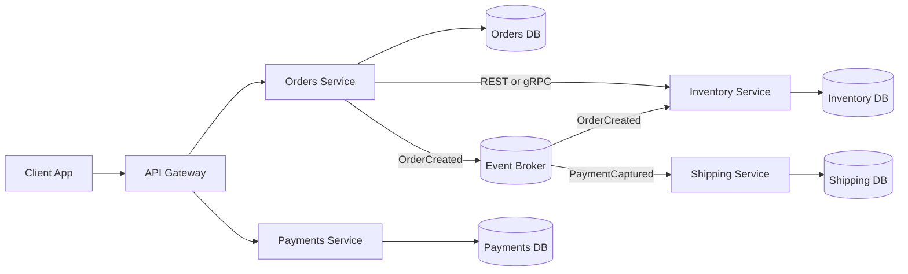

Microservices divide a system into services that can be changed and deployed independently. Each service owns a business capability and the data behind it. The useful boundary is deployment independence: separate processes alone do not make a microservice architecture.

This style starts paying for itself when teams block one another's releases or parts of the system need sharply different scaling and availability. It also moves work out of the compiler and into production. Network latency, partial failure, asynchronous consistency, and a larger operational surface become everyday design constraints.

# Core Principles

- **Boundaries follow business capabilities.** Orders, Inventory, Billing, and Shipping are plausible boundaries because each contains its own rules and language.
- **Data has one owner.** A service controls its schema and persistence model. Other services use its contract instead of reading its tables. Separate database servers are optional. Exclusive ownership is not.
- **Integration happens through contracts.** Versioned APIs and events carry data across boundaries. Shared libraries stay small enough that one team's release cannot force another's.
- **Deployment is independent.** A service can ship, roll back, and scale without coordinating a full-system release.
- **Governance stays thin.** Platform standards cover cross-cutting concerns while teams retain control of domain choices.

# Communication Patterns

A synchronous call fits a decision that must complete before the caller can continue. [[Networks/Protocols/REST]] and [[Networks/Protocols/gRPC]] both serve that case. A short synchronous path is safer. A chain such as `A -> B -> C -> D` adds every dependency's latency and gives each failure another route back to the client.

[[Software Architecture/Distributed Systems/Message Queues/Message Queues|Message Queues]] and [[Software Architecture/System Architecture/Event-Driven Architecture]] fit work that can continue later. An immutable `OrderPlaced` event can start reservation or notification work after the request has returned. Consumers still need idempotency because a broker may redeliver a message after an uncertain acknowledgement.

The boundary is the business decision. A direct call fits when an immediate answer is part of that decision. A published fact fits when independent work can happen afterward.

# Implementation and Operations

An independently deployable service can run in a container, virtual machine, managed application platform, or function service. Docker and Kubernetes are delivery choices, not defining properties of microservices.

Each service needs a small operating contract:

- an owner and escalation path.
- supported API or event versions, plus the build artifact and rollback procedure.
- service-level indicators with alert thresholds.
- correlation across logs, metrics, traces, synchronous calls, and messages.
- request deadlines, bounded retries, circuit breaking, and load shedding.
- audited configuration and secret delivery.
- datastore ownership, migration order, backup, and restore evidence.

A platform should make these basics cheap without forcing one topology onto every service. A low-volume internal API can run on App Service. A partitioned consumer fleet may justify Kubernetes, while a scheduled job can remain a managed container task.

Kubernetes supplies declarative rollout, service discovery, probes, and resource controls. It cannot supply correct service boundaries or safe database migrations. Resource requests should come from measurements. Disruption budgets come from the required availability. Readiness should report whether this instance can serve traffic. If every pod fails readiness during a shared database outage, the cluster removes all routes even though another pod cannot improve the result.

# Microservices vs. Monolith vs. Modular Monolith

| Dimension | [[Software Architecture/System Architecture/Monolith Architecture\|Monolith]] | [[Software Architecture/System Architecture/Modular Monolith]] | Microservices |
|---|---|---|---|
| Deployments | Single unit | Single unit with strict module boundaries | Independent service deployments |
| Team model | Shared ownership | Team ownership by module | Team ownership by service |
| Data model | Shared database | Shared database with modular access rules | Database per service |
| Runtime calls | In-process | In-process | Network calls |
| Operational complexity | Low | Low to medium | High |
| Best fit | Small team, early product | Growing product, clear domains, limited ops capacity | Large org, high release velocity, independent scaling needs |

[[Software Architecture/System Architecture/Monolith Architecture]] is usually the safest starting point while domain boundaries are still moving. It keeps refactoring local and failure modes visible. Distribution can wait until a real constraint appears.

# Migration Boundary

A migration should remove a measured constraint. Moving the same coupling across a network only makes it harder to see. A good first candidate has clear ownership, isolatable data, and release or scaling pressure that already costs the organization. The most central workflow is usually a poor first extraction because it hides the most dependencies and makes rollback hardest.

## Staged Extraction

1. **Measure the pressure.** Deployment wait time, change collisions, uneven load, and incidents caused by the candidate boundary are recorded.
2. **Create an in-process seam.** The capability moves behind a contract inside the monolith, and direct table or internal-code access is blocked.
3. **Assign data ownership.** Writes move behind that contract. Explicit queries, replicated read models, or events replace cross-boundary joins.
4. **Introduce the remote implementation.** A controlled cohort is routed through HTTP, gRPC, or messaging while the old path remains available.
5. **Prove independent operation.** The service is deployed and rolled back alone, dependency failure is exercised, and traces and alerts are verified.
6. **Retire the old path.** Duplicate code and tables are removed only after traffic, reconciliation, and rollback windows show the new owner is stable.

This is a strangler migration. The replacement grows around a working system, one boundary at a time.

## Extraction Gate

`Billing` is ready to leave `Orders` when it owns payment-intent state behind a versioned contract, Orders has stopped touching Billing tables, and either side can release alone. Its outage policy must be explicit: Orders rejects, queues, or degrades. Trace and causation identifiers connect the request to later messages, and reconciliation catches orders whose payment state does not converge. Until those conditions hold, the boundary belongs in-process.

## Data Migration

A single writer is preferable during transition:

1. The new store is backfilled from a consistent snapshot.
2. Later changes are captured through an outbox or change-data-capture stream.
3. Counts and business invariants are compared between stores.
4. Reads for a small cohort are routed to the new owner.
5. Writes are switched only when lag is zero and rollback can replay the retained change stream.
6. The old writer is stopped first, and its tables are removed after the recovery window.

Uncontrolled dual writes create two sources of truth. If a transition cannot avoid them, the authoritative store is named and reconciliation is built before the first production write.

## Migration Evidence

| Claim | Evidence before extraction | Evidence after extraction |
| --- | --- | --- |
| Faster delivery | Candidate changes wait on shared pipeline | Service releases without monolith release |
| Independent scaling | Candidate saturates while rest is idle | Service scales without multiplying whole app |
| Better isolation | Candidate incidents affect whole deploy | Failure drill contains impact at contract boundary |
| Clear ownership | Multiple teams modify same internals | One team owns contract, data, SLO, and pager |

Extraction stops when the next candidate lacks a measurable constraint. One monolith beside a few services can be a stable architecture. The visuals below show Airbnb's historical migration rather than a universal sequence.

![[Assets/Software Architecture/Software Architecture-Microservices-18120000-3.png|theme-aware]]

Airbnb's multi-year evolution shows services being extracted as organizational and scaling pressure appeared. It does not support a target service count.

![[Assets/Software Architecture/Software Architecture-Microservices-18120000-4.jpg|theme-aware]]

Its later use of both microservices and larger macroservices shows that service size should follow ownership and change coupling.

# Boundaries and Delivery Independence

A service boundary is credible only when one team can change and operate it without a lockstep release. Shared writable tables or paired deployments create a distributed monolith even when the processes run separately. A mandatory synchronous chain can do the same.

![[Assets/Software Architecture/Software Architecture-Microservices-18120000.png|theme-aware]]

This capability map is a menu. Gateways and meshes answer specific operating needs. Containers and separate databases do not create sound domain boundaries by themselves.

![[Assets/Software Architecture/Software Architecture-Microservices-18120000-2.png|theme-aware]]

Ownership and explicit failure behavior are the baseline. Cross-boundary telemetry shows whether those promises hold once requests and messages leave a process.

# Production Platform Capabilities Are Conditional

![[Assets/Software Architecture/Software Architecture-Microservices-18120000-1.png|theme-aware]]

The pictured components answer observed failure modes or platform constraints. None is a prerequisite for a microservice architecture.

# Workflow Ownership: Orchestration versus Choreography

Workflow ownership crosses service boundaries. For `Charge -> Reserve -> Ship`, [[Software Architecture/Distributed Systems/Orchestration|orchestration]] gives one durable process manager responsibility for incomplete state and compensation. For `OrderPlaced -> email + analytics + search indexing`, [[Software Architecture/Distributed Systems/Choreography|choreography]] lets independent services react without inventing a coordinator that makes no business decision. A single workflow can use both: orchestrate the transaction, then publish facts for unrelated reactions.

# When Microservices Are the Wrong Fit

A modular monolith fits better while domain boundaries change weekly, one team owns the product, and deployments do not block delivery. It is also the honest choice when the team cannot support distributed tracing, on-call ownership, or asynchronous consistency. Microservices replace some compile-time coupling with network and operational coupling. Coordination never disappears for free.

A useful stop rule is simple. If extracting `Catalog` creates its own pipeline, datastore, dashboard, pager, and compatibility contract while releases remain coordinated with the monolith, the extraction has bought cost without independence. In that case, the in-process boundary is restored, and extraction waits until the constraint changes.

# Pitfalls

**Distributed monolith.** Processes are separate, but shared tables and lockstep releases keep them coupled. Splitting by technical layer often causes this shape. Business boundaries, exclusive data ownership, and short call paths make independence testable.

**Partial business state.** One service commits before another fails. Distributed ACID protocols such as two-phase commit can coordinate supported resources, though they add coupling and difficult recovery. Most workflows instead use local transactions, an outbox, idempotent consumers, and compensation.

**Operational overload.** Every service adds a build, deployment surface, dependencies, telemetry, and an on-call burden. A platform can standardize the common path, but it cannot erase that cost. Too many small services make incidents a graph traversal exercise.

**Retry storms.** Network calls fail slowly and sometimes ambiguously. Deadlines limit the wait. Bounded retries with jitter avoid synchronized pressure. Circuit breakers and backpressure stop a struggling dependency from pulling the rest of the system down.

# Questions

> [!qard]- What is a microservices architecture?
> A microservices architecture splits a system into services that can be deployed independently. Each service is built around one business capability, owns that capability's data, and works with other services only through network contracts such as APIs and events.
>
> - **Independent deployment:** a service can be released, rolled back and scaled without a coordinated release of the whole system. This is the property the style exists for; running code in separate processes does not by itself make it a microservice architecture.
> - **Business-capability boundaries:** services such as Orders, Inventory and Billing each contain their own rules and language, instead of the system being split by technical layer.
> - **Exclusive data ownership:** only the owning service accesses its data directly, and other services go through its contract. Separate database servers are optional; exclusive ownership is not.
> - **Contract-based integration:** versioned APIs and events carry data between services, so one service's internals can change without forcing another team to release.
>
> The cost is that calls become network calls that can fail partially, workflows that span services lose single-database transactions, and every service needs its own pipeline, monitoring and on-call ownership.
>
> [Azure: Microservices architecture style](https://learn.microsoft.com/en-us/azure/architecture/guide/architecture-styles/microservices)

<!-- qard-id: 2f039fe1-5942-48b0-8416-ab06d23915ef -->

> [!qard]- Why do microservices create distributed data consistency problems, and what keeps a cross-service workflow reliable?
> Each service commits only to its own datastore, so a business operation that spans several services has no single local ACID transaction by default. One service can commit while a later step fails, which leaves partial business state. While the workflow runs, other services can also observe intermediate state, so the overall result is eventually consistent rather than atomic.
>
> A reliable cross-service workflow combines separate mechanisms, each covering a different failure:
>
> | Mechanism | Failure it handles | How it handles it |
> |---|---|---|
> | Saga | A later step fails after earlier steps have committed | The workflow runs as a sequence of local transactions. When a step fails, compensating business actions counteract completed steps where possible, such as refunding a payment or releasing a stock reservation. |
> | Transactional outbox | The service crashes between committing its data and publishing the related message | The state change and the outgoing message are written in the same local transaction, and a relay publishes the message afterward. A committed change therefore always has a stored message waiting to be published, and a rolled-back change is never announced. |
> | Inbox or deduplication record | The same message arrives again, for example after a relay retry or an unconfirmed acknowledgement | The consumer records which messages it has already processed and skips repeats. |
> | Idempotent effects | A command or handler is retried | Repeating the operation leaves the same result as performing it once. |
>
> Compensation is a new business action, not a database rollback, and it has two separate limits. Some committed steps have no compensating action at all. Such noncompensable (pivot) work cannot be undone once it commits, so compensation cannot restore the earlier state. Where a compensating action does exist, it can itself fail. The outbox does not make delivery exactly-once: a message can still arrive more than once, which is why consumers need deduplication or idempotent effects.
>
> [Azure: Saga pattern](https://learn.microsoft.com/en-us/azure/architecture/patterns/saga) · [Azure: Transactional outbox with Azure Cosmos DB](https://learn.microsoft.com/en-us/azure/architecture/databases/guide/transactional-out-box-cosmos) · [Azure: Event-driven architecture style](https://learn.microsoft.com/en-us/azure/architecture/guide/architecture-styles/event-driven)

<!-- qard-id: b0b30416-18f1-43d0-be97-f7d92c1bd721 -->

> [!qard]- What architecture usually fits a new product, and what evidence would justify moving to microservices?
> A new product is usually best served by a monolith, ideally a modular monolith with explicit internal boundaries. Moving toward microservices is justified one capability at a time, when measured evidence shows that a stable capability repeatedly needs independent deployment, scaling, ownership or isolation, and the team can operate the resulting distributed system.
>
> **Why one deployment usually fits first:**
>
> - Domain boundaries in a new product are still moving. Inside one deployment, moving a boundary is an ordinary refactoring; between services, it means changing contracts, data ownership and deployments.
> - Calls between collocated modules stay in-process, and transactions across those modules can stay local. These internal calls need no network failure handling or cross-service consistency work yet. Calls to external dependencies, such as a database or a third-party API, can still fail.
> - One deployable unit is cheaper to operate than many services, each with its own pipeline, telemetry and on-call duty.
>
> **What counts as evidence:** measured costs of the shared deployment, such as release wait time, change collisions between teams, one workload saturating while the rest of the application is idle, or incidents in one area spreading to unrelated features. A preference for microservices or an expected future scale is not evidence by itself.
>
> **Operational readiness:** every extracted service adds network failure modes for its callers. A workflow whose steps commit to independently owned state also becomes eventually consistent. An extraction that only serves reads need not create such a workflow. Without distributed tracing, on-call ownership and experience with asynchronous consistency, those costs outweigh the gain.
>
> This is a conditional judgment, not a universal monolith-first rule. A monolith alongside a few extracted services can be a stable end state.
>
> [Azure: Microservices architecture style](https://learn.microsoft.com/en-us/azure/architecture/guide/architecture-styles/microservices)

<!-- qard-id: 4f8727f6-b1fa-40aa-8527-127b4090be74 -->

> [!qard]- What evidence shows that an extracted service is independent rather than part of a distributed monolith?
> An extracted service is independent when its owning team can change, deploy, roll back and operate it without a coordinated release elsewhere. A distributed monolith fails that test: its processes run separately, but its parts still change or fail together. Shared writable tables and paired deployments create that coupling directly. A mandatory synchronous call chain can create it too, when its contracts cannot evolve compatibly, its releases must be paired, or a dependency's failure is not contained. Synchronous communication alone does not force lockstep change.
>
> Evidence of independence:
>
> - **Unpaired release and operation:** the service ships and rolls back on its own, and its team runs it with its own alerts and on-call duty.
> - **Exclusive data ownership:** only the service writes its data; other components use its contract instead of reading or writing its tables.
> - **Versioned contract:** consumers depend on a published API or event schema that can evolve compatibly, not on shared internals.
> - **Exercised failure behavior:** dependency failures have been tested, and callers reject, queue or degrade as designed instead of letting the failure spread.
>
> Traces and reconciliation show that synchronous calls and later messages can be followed across the boundary, and that diverging state gets detected. That is useful evidence, but it does not prove independence on its own: a fully traced service can still require lockstep releases.
>
> [Azure: Microservices architecture style](https://learn.microsoft.com/en-us/azure/architecture/guide/architecture-styles/microservices) · [Azure: Event-driven architecture style](https://learn.microsoft.com/en-us/azure/architecture/guide/architecture-styles/event-driven)

# References

- [Microservices](https://martinfowler.com/articles/microservices.html)
- [.NET microservices architecture guide](https://learn.microsoft.com/en-us/dotnet/architecture/microservices/)
- [Building Microservices, Second Edition](https://samnewman.io/books/building_microservices_2nd_edition/)
- [Decompose by business capability](https://microservices.io/patterns/decomposition/decompose-by-business-capability.html)
