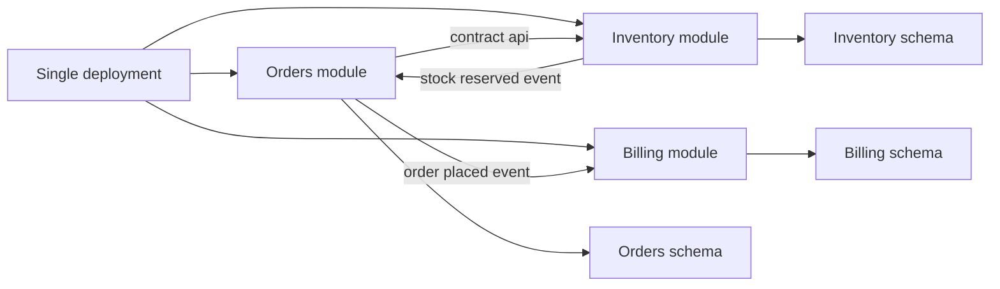

A modular monolith keeps one process and one deployment while dividing the codebase into modules that own distinct business capabilities. It captures much of what teams want from [[Software Architecture/System Architecture/Microservices]]: clearer ownership and safer parallel change, without turning every boundary into a network call. For most growing products, that is the sensible default. Boundaries are strengthened inside the application first. A module is distributed only when delivery, scaling, or isolation pressure justifies the operating cost.

# Enforcing Module Boundaries In-Process

Each module owns its domain model, application behavior, persistence, and public contract. Code outside the module sees only that contract.

- **Code boundary**: contracts such as commands, events, DTOs, and interfaces live in a small contracts assembly. Another module cannot reference internal domain or infrastructure types.
- **Data boundary**: each table has one owner. Separate `DbContext` types and schemas make ownership visible, while direct cross-module reads remain forbidden.
- **Runtime boundary**: communication stays in process while the modules share a deployment. A future move to HTTP, gRPC, or messaging changes latency, failure, and transaction semantics even if the application-facing interface keeps the same shape.

But a contracts assembly does not enforce any of this by itself. Project references, architecture tests, and database permissions must make boundary violations harder than using the published contract.



> [!IMPORTANT]
> **Data isolation makes the transaction boundary visible.** Separate `DbContext` types or schemas can still share one local ACID transaction when they use the same relational database, connection, and provider transaction. Once modules use separate databases or a broker, that guarantee ends. Each module then commits its independently owned state locally. A local commit that must also announce a message uses an outbox or another durable handoff, so the message cannot be lost after the commit.

# .NET Implementation

Separate projects give the compiler and architecture tests something concrete to reject:

```text
src/
  Modules/
    Orders/
      Orders.Contracts/
      Orders.Core/
      Orders.Infrastructure/
    Inventory/
      Inventory.Contracts/
      Inventory.Core/
      Inventory.Infrastructure/
  Host/
  Shared.Kernel/
```

`Orders.Core` may reference `Inventory.Contracts`. References to `Inventory.Core` or `Inventory.Infrastructure` are boundary violations. The contracts assembly stays narrow:

```csharp
namespace Inventory.Contracts;

public sealed record ReserveStockRequest(
    Guid ProductId,
    int Quantity,
    Guid OrderId);

public sealed record ReserveStockResult(bool Success, string? FailureCode);

public interface IInventoryGateway
{
    Task<ReserveStockResult> ReserveAsync(
        ReserveStockRequest request,
        CancellationToken cancellationToken);
}
```

The Orders handler depends on that contract instead of Inventory internals:

```csharp
public interface IUnitOfWork
{
    Task<T> ExecuteAsync<T>(
        Func<CancellationToken, Task<T>> operation,
        CancellationToken cancellationToken);
}

public sealed class PlaceOrderHandler(
    IInventoryGateway inventory,
    IOrderRepository orders,
    IUnitOfWork unitOfWork)
{
    public Task<Result> HandleAsync(
        PlaceOrderCommand command,
        CancellationToken cancellationToken)
    {
        if (command.Quantity <= 0)
        {
            return Task.FromResult(Result.Failure("orders.invalid_quantity"));
        }

        return unitOfWork.ExecuteAsync(async transactionToken =>
        {
            var reservation = await inventory.ReserveAsync(
                new ReserveStockRequest(
                    command.ProductId,
                    command.Quantity,
                    command.OrderId),
                transactionToken);

            if (!reservation.Success)
            {
                return Result.Failure(
                    reservation.FailureCode ?? "inventory.unavailable");
            }

            await orders.AddAsync(
                Order.Create(command.OrderId, command.CustomerId),
                transactionToken);

            return Result.Success();
        }, cancellationToken);
    }
}
```

This example assumes `ExecuteAsync` saves every participating context and commits the shared local transaction. `AddAsync` alone only stages the order. If Inventory moves behind a network boundary, the handler must become a durable workflow with idempotent reservation and compensation. The local unit of work can no longer cover both modules.

## Module-owned Registration

Each infrastructure assembly owns its persistence registration and migrations history. The host composes modules through their registration methods and does not reach into domain or persistence types.

```csharp
public static class InventoryModuleExtensions
{
    public static IServiceCollection AddInventoryModule(
        this IServiceCollection services,
        IConfiguration configuration)
    {
        var connectionString = configuration.GetConnectionString("Application")
            ?? throw new InvalidOperationException(
                "Connection string 'Application' is required.");

        services.AddDbContext<InventoryDbContext>(options =>
            options.UseNpgsql(
                connectionString,
                postgres => postgres.MigrationsHistoryTable(
                    "__EFMigrationsHistory",
                    "inventory")));

        services.AddScoped<IInventoryGateway, InventoryGateway>();
        services.AddScoped<IInventoryRepository, InventoryRepository>();

        return services;
    }
}
```

```csharp
var builder = WebApplication.CreateBuilder(args);

builder.Services.AddOrdersModule(builder.Configuration);
builder.Services.AddInventoryModule(builder.Configuration);

var app = builder.Build();
app.MapOrdersEndpoints();
app.Run();
```

## Shared Transaction when the Resource is Shared

Two `DbContext` instances can commit atomically when they share the same open relational connection and provider transaction:

```csharp
await using var connection = new NpgsqlConnection(connectionString);
await connection.OpenAsync(cancellationToken);

var ordersOptions = new DbContextOptionsBuilder<OrdersDbContext>()
    .UseNpgsql(connection)
    .Options;

var inventoryOptions = new DbContextOptionsBuilder<InventoryDbContext>()
    .UseNpgsql(connection)
    .Options;

await using var orders = new OrdersDbContext(ordersOptions);
await using var inventory = new InventoryDbContext(inventoryOptions);
await using var transaction = await orders.Database.BeginTransactionAsync(
    cancellationToken);

await inventory.Database.UseTransactionAsync(
    transaction.GetDbTransaction(),
    cancellationToken);

orders.Orders.Add(order);
inventory.Reservations.Add(reservation);

await orders.SaveChangesAsync(cancellationToken);
await inventory.SaveChangesAsync(cancellationToken);
await transaction.CommitAsync(cancellationToken);
```

Different schemas do not block the transaction because PostgreSQL is still one transactional resource. If either module moves to another database or broker, the shared commit disappears. A local change that must durably announce a message then includes an outbox record, and a cross-module workflow that continues asynchronously exposes that state instead of hiding it behind a method call.

# Extraction Path to Microservices

Good module boundaries reduce the amount of code touched during extraction. They do not make extraction transparent. A contract such as `IInventoryGateway` may preserve the use-case shape, but the network boundary changes the design:

1. Remote requests carry deadlines and cancellation, and callers then need a defined response for when Inventory is slow or unavailable.
2. Only idempotent operations are retried. Requests carry an idempotency key when duplicate execution is possible, and retries are capped so a partial outage does not become a retry storm.
3. Trace context is propagated, and dependency latency, errors, saturation, and retries are measured before traffic moves.
4. Local commits replace the process-wide transaction. A local business-state commit that must durably announce a message records it in an outbox in the same commit. Longer workflows may also need compensation or a saga.
5. Owned data moves through an explicit migration with backfill, reconciliation, rollback, and any required dual-read or dual-write window.

The interface may look familiar, but its contract now includes partial failure and eventual consistency. Module ownership narrows the migration surface. It cannot make a remote operation behave like a local method call.

# Collocation and Scale Cases

Collocation pays when work changes together, scales together, and moves a large amount of intermediate data. Prime Video's monitoring team reported that moving one tightly ordered video-analysis pipeline into a single process removed remote orchestration and transfer costs. That result belongs to the workload. It is not a blanket argument against services.

Stack Overflow's documented 2016 architecture shows another shape. Its stateless application tier scaled horizontally, with SQL Server, Redis, and search kept as specialized systems. The useful lesson is not the server count. A modular deployment can carry substantial load when request paths and database limits are understood and enough failure headroom remains.

These cases test the boundary decision. Modules stay together while their changes and scaling remain coupled. Extraction is justified only when independent deployment, stronger failure isolation, or asymmetric scaling repeatedly pays for the new network boundary.

# Pitfalls

- **Boundary erosion**: direct table reads or internal project references turn modules into folders. Architecture tests should fail the build when a shortcut crosses the contract.
- **Shared database coupling**: one database can preserve local ACID transactions, but shared tables and unowned migrations still couple modules. Each module owns a schema and `DbContext`, and data crosses modules through contracts or events.
- **Premature partitioning**: unstable domain boundaries create constant churn. A few bounded contexts make a safer start, with further splits once ownership or scaling evidence makes the seam durable.

# Tradeoffs

| Criterion | Traditional Monolith | Modular Monolith | Microservices |
|---|---|---|---|
| Deployment | Single unit | Single unit | Independent service deployments |
| Team model | Shared ownership across codebase | Ownership by module with explicit contracts | Ownership by service with strong autonomy |
| Data isolation | Usually shared schema and shared table access | Isolated schema or strict table ownership per module | Database per service with hard isolation |
| Runtime overhead | Lowest in process calls | Low in process calls plus boundary discipline | Highest due to network calls and resilience layers |
| Operational complexity | Low | Low to medium | High observability platform and deployment orchestration needs |
| Extraction cost | High if internals are tangled | Medium: contracts reduce code churn, but remote failure semantics and data migration remain | Not applicable: already extracted |

A modular monolith is the default for a product that needs durable boundaries but can still ship as one unit. A traditional monolith is enough for a small or short-lived system. Microservices earn their cost when independent deployment, isolation, or scaling repeatedly blocks delivery.

# Questions

> [!qard]- What is a modular monolith?
> A modular monolith is a single deployable application whose code and data are divided into modules, each owning one business capability behind an explicit contract. It keeps a monolith's single deployment and in-process calls while giving each module clear ownership.
>
> - **Code boundary:** each module exposes a small public contract, such as commands, events, DTOs and interfaces. Other modules use that contract and do not reference the module's internal domain or infrastructure types.
> - **Data boundary:** each table has one owning module, often made visible with a separate schema and `DbContext`. Other modules do not read or write those tables directly.
> - **Runtime:** modules are released together and normally run in the same process, so calls between them are in-process. With EF Core on a relational database, modules can also commit together in one local transaction when their `DbContext` instances share the same `DbConnection` and `DbTransaction`; using the same database alone is not enough.
>
> The boundaries hold only when they are enforced. Project references, architecture tests that fail the build, and database permissions make crossing a boundary harder than using the contract. Without that enforcement, direct table reads and internal references erode the modules into ordinary folders.
>
> [Kamil Grzybek: Modular Monolith: A Primer](https://www.kamilgrzybek.com/blog/posts/modular-monolith-primer) · [EF Core: Using transactions](https://learn.microsoft.com/en-us/ef/core/saving/transactions)

<!-- qard-id: 77e3a78b-e6d8-4560-9399-33f66b9fc20b -->

> [!qard]- When is a modular monolith a better fit than microservices, and what signals justify extracting a module?
> A modular monolith fits better when strong module boundaries are valuable but one deployment, in-process calls and local transactions still serve the system well. Extracting a module is justified when it repeatedly needs independent release, scaling or isolation, and that need outweighs the cost of a new network boundary.
>
> | Aspect | Module inside a modular monolith | Module extracted as a service |
> |---|---|---|
> | Release | Ships and rolls back with every other module, so unrelated changes can delay it | Ships and rolls back on its own schedule |
> | Scaling | Scales only by replicating the whole application | Scales independently |
> | Calls | In-process, with no network between caller and module. A call can still hang, or throw after producing effects | Over the network, adding latency and transient failures. After a timeout or lost connection, the caller may not know whether the operation completed |
> | Transactions | Can share one local transaction with another module when both `DbContext` instances use the same `DbConnection` and `DbTransaction`; using the same database alone is not enough | Commits only to its own store and cannot join the caller's transaction. When a local commit must also announce a change, an outbox records the message in that commit for later publication. Workflows spanning several services' commits may also need idempotent consumers and sometimes a saga |
> | Operations | Shares one pipeline and runtime with the rest of the application | Needs its own pipeline, telemetry and on-call ownership |
>
> The extraction signals are recurring costs of the shared unit. The module's changes keep waiting behind unrelated releases, its load forces the whole application to scale, or its failures and resource use must be contained away from other features. Keeping the same contract interface does not make a remote call local. Deadlines, safe retries, cross-boundary observability and transaction boundaries must therefore be designed explicitly, with an outbox wherever a local commit must durably publish a message.
>
> [Azure: Microservices architecture style](https://learn.microsoft.com/en-us/azure/architecture/guide/architecture-styles/microservices) · [Azure: Saga pattern](https://learn.microsoft.com/en-us/azure/architecture/patterns/saga) · [EF Core: Using transactions](https://learn.microsoft.com/en-us/ef/core/saving/transactions) · [Azure: Transactional outbox with Azure Cosmos DB](https://learn.microsoft.com/en-us/azure/architecture/databases/guide/transactional-out-box-cosmos) · [Azure: Retry pattern](https://learn.microsoft.com/en-us/azure/architecture/patterns/retry)

> [!qard]- When a modular-monolith module is extracted into a service, what must be redesigned even if its contract interface stays the same?
> The interface can keep the same methods, but each call now crosses a network, which changes its latency, failure and transaction behavior. Local calls can already hang, or throw after producing an effect. The network adds another kind of uncertainty: after a timeout or lost connection, the caller may not know whether the service completed the operation. The remote call also can no longer join the caller's local transaction.
>
> What has to be redesigned:
>
> 1. **Deadlines and cancellation:** remote requests get time limits, and callers need a defined response when the service is slow or unavailable, such as rejecting, queuing or degrading.
> 2. **Retries:** a request is retried only when repeating it is safe. Either the operation is naturally idempotent, or it carries an idempotency key that stays the same across retries of one logical request, so the service recognizes a repeat after an attempt that may already have succeeded. Retries are capped so a partial outage does not become a retry storm.
> 3. **Observability:** trace context crosses the boundary, and dependency latency, errors, saturation and retries are measured before traffic moves.
> 4. **Transactions:** the shared local transaction no longer covers both sides, so each side commits only its own state. When a local commit must also publish a message that others depend on, an outbox records the message in the same commit for later publication, so a committed change cannot lose its message. Longer workflows may also need compensation or a saga.
> 5. **Data:** the module's data moves to its own store through an explicit migration with backfill, reconciliation and rollback.
>
> Good module boundaries reduce how much code changes during extraction, but they cannot make a remote operation behave like a local method call.
>
> [Azure: Retry pattern](https://learn.microsoft.com/en-us/azure/architecture/patterns/retry) · [Azure: Transactional outbox with Azure Cosmos DB](https://learn.microsoft.com/en-us/azure/architecture/databases/guide/transactional-out-box-cosmos) · [Azure: Saga pattern](https://learn.microsoft.com/en-us/azure/architecture/patterns/saga)

# References

- [Modular Monolith with DDD](https://github.com/kgrzybek/modular-monolith-with-ddd)
- [Modular Monolith: A Primer](https://www.kamilgrzybek.com/blog/posts/modular-monolith-primer)
